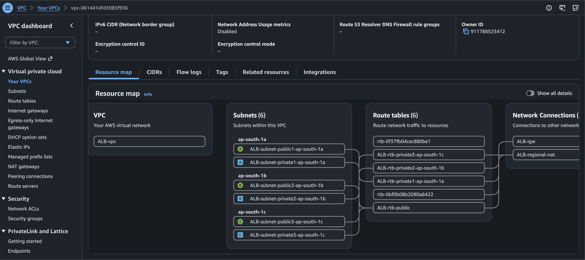
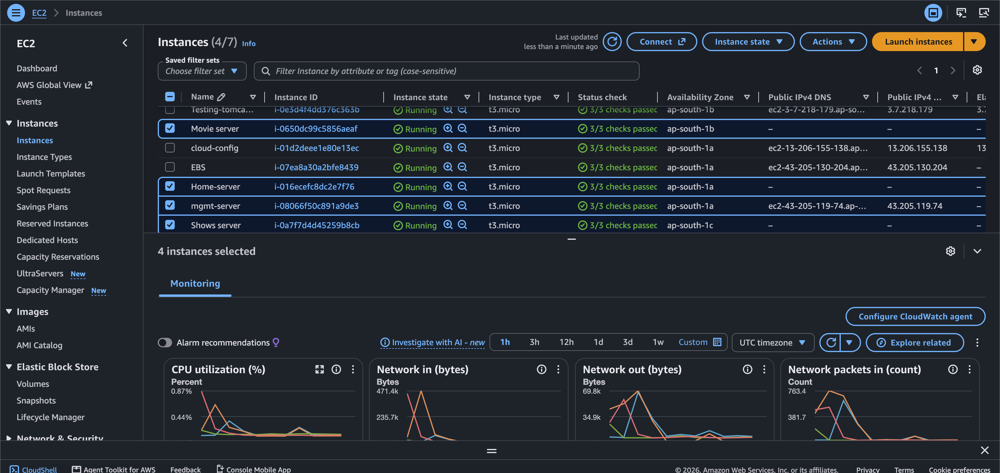
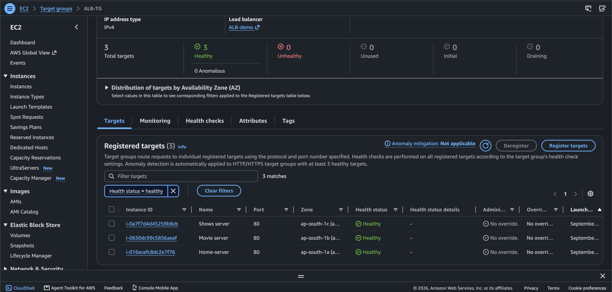
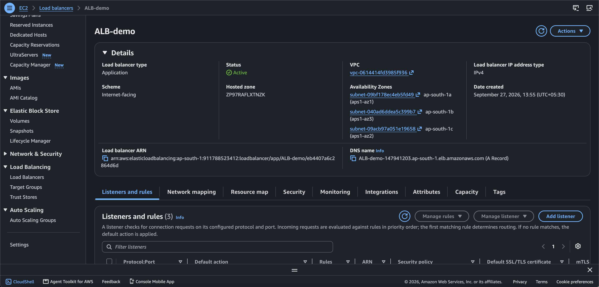
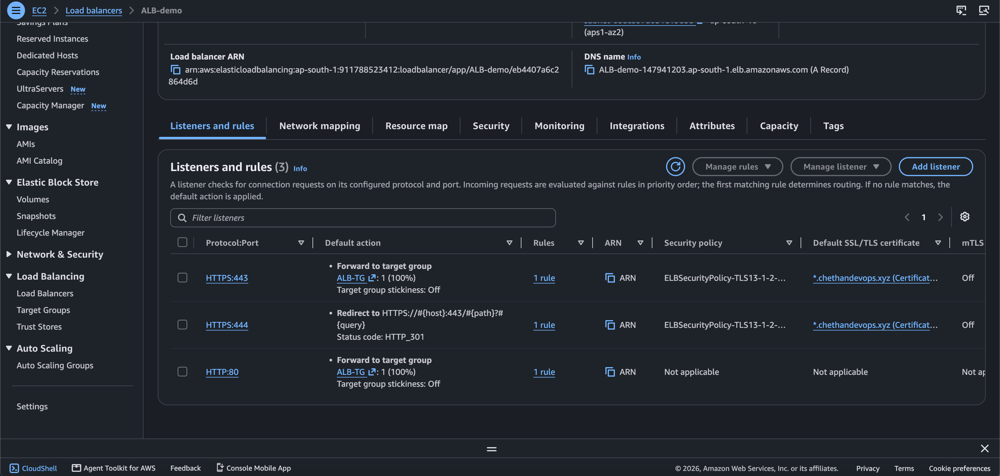
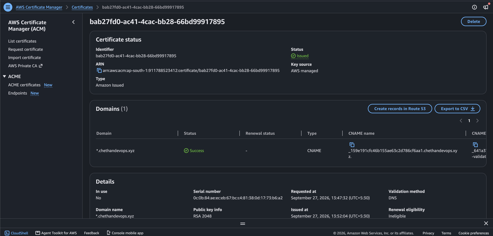
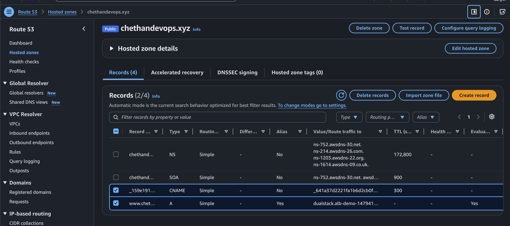
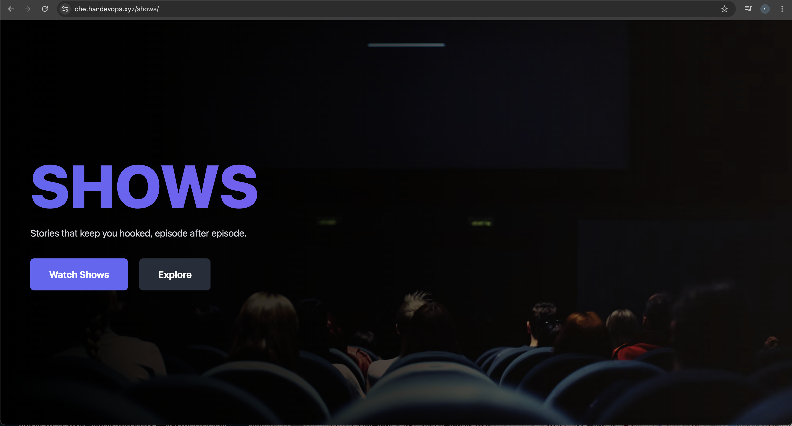
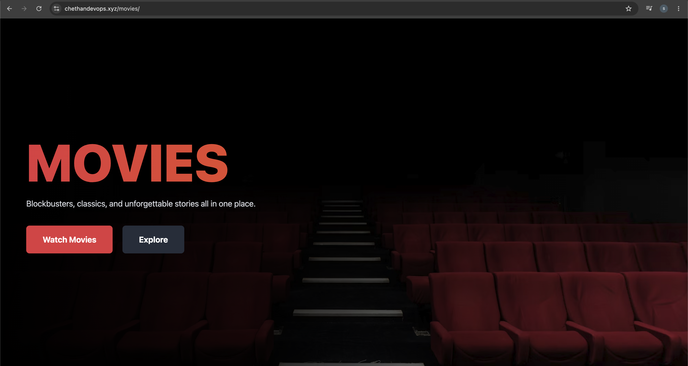

# 🚀 Day 13 — AWS Application Load Balancer (ALB)

## 📌 Project Overview

This is a personal hands-on project to understand and implement an **AWS Application Load Balancer (ALB)** with private EC2 backend servers.

In this project, I created:

* 1 Public EC2 instance for management/bastion access
* 3 Private EC2 instances as backend web servers
* NGINX web servers on the private EC2 instances
* 3 ALB Target Groups
* 1 Internet-facing Application Load Balancer
* Path-based routing for Home, Shows, and Movies
* Route 53 DNS
* AWS Certificate Manager (ACM) SSL/TLS certificate
* HTTP → HTTPS redirection

The final request flow was:

```text
User Browser
     |
     v
Route 53
     |
     v
Application Load Balancer
     |
     +--------------------+--------------------+
     |                    |                    |
     v                    v                    v
Home Target Group    Shows Target Group   Movies Target Group
     |                    |                    |
     v                    v                    v
Private EC2 #1       Private EC2 #2       Private EC2 #3
   NGINX                 NGINX                NGINX
```

---

# 🏗️ Architecture

```text
                         🌐 Internet
                              |
                              v
                       Route 53 DNS
                              |
                              v
                  ┌─────────────────────┐
                  │  Application Load   │
                  │     Balancer        │
                  │      ALB            │
                  └─────────────────────┘
                         /    |    \
                        /     |     \
                       /      |      \
                      v       v       v
                 Home TG   Shows TG  Movies TG
                    |         |         |
                    v         v         v
               Private EC2  Private EC2  Private EC2
                  NGINX       NGINX        NGINX
                    |           |            |
                    v           v            v
                 Home Page   Shows Page   Movies Page


             Public Management EC2
                      |
                      | SSH / Management
                      v
                Private EC2s
```

---

# 🛠️ AWS Services Used

* Amazon VPC
* Amazon EC2
* Application Load Balancer (ALB)
* Target Groups
* NGINX
* Amazon Route 53
* AWS Certificate Manager (ACM)
* NAT Gateway
* Security Groups
* HTTPS / TLS

---

# 1️⃣ Create VPC

I created a VPC for the ALB project.

### VPC

```text
Name: ALB-vpc
CIDR: 10.0.0.0/16
```

I created multiple subnets across Availability Zones.

### Subnet structure

```text
Public Subnets
├── Public Subnet 1
├── Public Subnet 2
└── Public Subnet 3

Private Subnets
├── Private Subnet 1
├── Private Subnet 2
└── Private Subnet 3
```

The Application Load Balancer was placed in the **public subnets**.

The backend EC2 instances were placed in the **private subnets**.

---

# 2️⃣ Create Internet Gateway

I created and attached an Internet Gateway to the VPC.

The Internet Gateway provides Internet connectivity for the public subnet.

```text
Internet
    |
    v
Internet Gateway
    |
    v
ALB Public Subnets
```

---

# 3️⃣ Create NAT Gateway

I created a NAT Gateway for outbound Internet connectivity from the private subnet.

```text
Private EC2
     |
     v
NAT Gateway
     |
     v
Internet
```

The NAT Gateway used:

```text
Name: ALB-regional-nat
```

---

# 4️⃣ Create Public EC2 Instance

I created **1 public EC2 instance** to use as a management/bastion server.

This instance was placed inside the public subnet.

The public EC2 was used to connect to and manage the private EC2 instances.

```text
Internet
    |
    v
Public EC2
    |
    v
Private EC2s
```

---

# 5️⃣ Create 3 Private EC2 Instances

I created **3 private EC2 instances**.

These instances did not have public IP addresses.

They were used as backend web servers.

```text
Private EC2 #1 → Home
Private EC2 #2 → Shows
Private EC2 #3 → Movies
```

Each private EC2 instance had NGINX installed using **User Data during EC2 creation**.

---

# 6️⃣ Configure Private EC2 #1 — Home Server

When creating the first private EC2 instance, I used User Data to install and configure NGINX.

The purpose of this server was to serve the Home page.

After connecting to the instance, I worked inside:

```bash
sudo su -
cd /var/www/html/
```

The Home page was configured under the NGINX web root.

---

# 7️⃣ Configure Private EC2 #2 — Shows Server

The second private EC2 was used for the Shows page.

I accessed the server and went to:

```bash
sudo su -
cd /var/www/html/
```

Then created the Shows directory:

```bash
mkdir -p shows
```

Then entered the directory:

```bash
cd shows/
```

The Shows page was placed inside this directory.

The resulting structure was:

```text
/var/www/html/
└── shows/
    └── index.html
```

---

# 8️⃣ Configure Private EC2 #3 — Movies Server

The third private EC2 was used for the Movies page.

I accessed the server and went to:

```bash
sudo su -
cd /var/www/html/
```

Then created the Movies directory:

```bash
mkdir -p movies
```

Then entered the directory:

```bash
cd movies/
```

The Movies page was placed inside this directory.

The resulting structure was:

```text
/var/www/html/
└── movies/
    └── index.html
```

---

# 9️⃣ NGINX Web Server

NGINX was used as the web server on all three private EC2 instances.

The basic flow was:

```text
ALB
 |
 v
Private EC2
 |
 v
NGINX
 |
 v
HTML Page
```

Each backend EC2 served a different page.

```text
Home EC2   → Home page
Shows EC2  → Shows page
Movies EC2 → Movies page
```

---

# 🔟 Create HTML Pages

I created three HTML source files for the project:

```text
home.html
movie.html
shows.html
```

These pages were designed as simple streaming-service style pages.

The pages were used to demonstrate that ALB path-based routing can send users to different backend applications/pages.

---

# 1️⃣1️⃣ Create Target Groups

I created three ALB target groups.

```text
Home Target Group
Shows Target Group
Movies Target Group
```

Each target group contained its corresponding private EC2 instance.

### Target Group Mapping

```text
Home Target Group
        |
        v
Private Home EC2


Shows Target Group
        |
        v
Private Shows EC2


Movies Target Group
        |
        v
Private Movies EC2
```

I checked the target health and verified that the backend targets became:

```text
Healthy
```

---

# 1️⃣2️⃣ Create Application Load Balancer

I created an **Internet-facing Application Load Balancer**.

The ALB was deployed across multiple public subnets.

The ALB acts as the entry point for users.

```text
Internet
    |
    v
ALB
```

The ALB then forwards requests to the appropriate target group.

---

# 1️⃣3️⃣ Configure HTTP Listener

I configured an HTTP listener on:

```text
Port: 80
Protocol: HTTP
```

The HTTP listener was configured to redirect HTTP traffic to HTTPS.

```text
HTTP :80
   |
   v
HTTPS :443
```

---

# 1️⃣4️⃣ Request ACM Certificate

I requested an SSL/TLS certificate using **AWS Certificate Manager (ACM)**.

The domain used for the project was:

```text
chethandevops.xyz
```

After completing domain validation, the ACM certificate status became:

```text
Issued
```

---

# 1️⃣5️⃣ Configure HTTPS Listener

I added an HTTPS listener to the Application Load Balancer.

```text
Port: 443
Protocol: HTTPS
```

I attached the ACM certificate to the HTTPS listener.

The final listener setup was:

```text
HTTP :80
   |
   | Redirect
   v
HTTPS :443
   |
   v
Target Groups
```

---

# 1️⃣6️⃣ Configure Route 53

I used Amazon Route 53 for DNS.

The domain used was:

```text
chethandevops.xyz
```

I created a DNS record pointing the domain to the Application Load Balancer.

```text
chethandevops.xyz
        |
        v
Application Load Balancer
```

---

# 1️⃣7️⃣ Configure ALB Path-Based Routing

I configured path-based routing rules on the Application Load Balancer.

### Home

```text
/
 ↓
Home Target Group
 ↓
Home EC2
```

### Shows

```text
/shows
 ↓
Shows Target Group
 ↓
Shows EC2
```

### Movies

```text
/movies
 ↓
Movies Target Group
 ↓
Movies EC2
```

This allows the same domain to serve different backend applications based on the URL path.

---

# 1️⃣8️⃣ Final Request Flow

### Home Request

```text
https://chethandevops.xyz/
             |
             v
            ALB
             |
             v
       Home Target Group
             |
             v
        Private EC2
             |
             v
           NGINX
             |
             v
         Home Page
```

### Shows Request

```text
https://chethandevops.xyz/shows
             |
             v
            ALB
             |
             v
       Shows Target Group
             |
             v
        Private EC2
             |
             v
           NGINX
             |
             v
         Shows Page
```

### Movies Request

```text
https://chethandevops.xyz/movies
             |
             v
            ALB
             |
             v
      Movies Target Group
             |
             v
        Private EC2
             |
             v
           NGINX
             |
             v
        Movies Page
```

---

# 1️⃣9️⃣ Testing

I tested the complete application from the browser.

### Test 1 — Home

```text
https://chethandevops.xyz/
```

The Home page loaded successfully.

### Test 2 — Shows

```text
https://chethandevops.xyz/shows
```

The Shows page loaded successfully.

### Test 3 — Movies

```text
https://chethandevops.xyz/movies
```

The Movies page loaded successfully.

### Test 4 — HTTP Redirect

I tested HTTP access and verified that the request was redirected from:

```text
HTTP :80
```

to:

```text
HTTPS :443
```

---

# 📸 Screenshots

## Architecture and Infrastructure

### 1. ALB VPC Architecture



### 2. EC2 Instances



### 3. Target Groups — Healthy Targets



### 4. Application Load Balancer



---

## HTTPS and DNS Configuration

### 5. ALB Listeners — HTTP and HTTPS



### 6. ACM Certificate Issued



### 7. Route 53 DNS Record



---

## Browser Testing

### 8. Home Page


### 9. Shows Page



### 10. Movies Page



---

# 📂 Project Structure

```text
Day-13-AWS-APPLICATION-LOAD-BALANCER/
│
├── README.md
│
├── home.html
├── movie.html
├── shows.html
│
└── screenshots/
    │
    ├── 01-ALB-VPC-Architecture.png
    ├── 02-ALB-EC2-Instances.png
    ├── 03-ALB-Target-Groups-Healthy.png
    ├── 04-ALB-Load-Balancer.png
    ├── 05-ALB-Listeners-HTTP-HTTPS.png
    ├── 06-ALB-ACM-Certificate-Issued.png
    ├── 07-ALB-Route53-DNS-Record.png
    ├── 08-ALB-Browser-Home.png
    ├── 09-ALB-Browser-Shows.png
    └── 10-ALB-Browser-Movies.png
```

---

# 🎯 Project Outcome

Successfully implemented an AWS Application Load Balancer architecture with:

* Public ALB
* Private backend EC2 instances
* NGINX web servers
* Multiple target groups
* Path-based routing
* Route 53 DNS
* ACM SSL/TLS certificate
* HTTPS listener
* HTTP → HTTPS redirect
* Successful browser testing for Home, Shows, and Movies

This project was completed as an **individual hands-on personal project** to practice AWS networking, load balancing, DNS, HTTPS, and backend routing.

