# Day 14 – AWS WAF with Terraform, Application Load Balancer and EC2

## Project Overview

This project demonstrates how to build and secure an AWS web application using Terraform, an Application Load Balancer (ALB), EC2 instances, and AWS Web Application Firewall (WAF).

The main infrastructure was provisioned using Terraform, while AWS WAF rules were configured manually through the AWS Management Console.

The project demonstrates how AWS WAF can protect a web application by blocking specific IP addresses, restricting traffic based on geographic location, and applying rate-based rules.

**Project objectives:**
- Provision AWS infrastructure using Terraform.
- Create a VPC with public and private subnets.
- Deploy EC2 instances in private subnets.
- Configure an Application Load Balancer.
- Enable HTTPS using an ACM certificate.
- Configure AWS WAF and associate it with the ALB.
- Block traffic from a specified IP address.
- Block traffic based on country.
- Configure a rate-based WAF rule.
- Test and validate the security rules.
- Destroy Terraform-managed infrastructure after testing.

## Architecture Diagram


## Architecture Flow

The request flow works as follows:

1. A user accesses the application using `https://www.chethandevops.xyz`.
2. DNS resolution is handled by Amazon Route 53.
3. The request reaches the Application Load Balancer.
4. AWS WAF evaluates the incoming request using the configured Web ACL rules.
5. If the request matches a blocking rule, WAF blocks it and returns an HTTP 403 response.
6. If the request is allowed, the ALB forwards it to a healthy EC2 instance in the target group.
7. The EC2 instance serves the application using Nginx.

## Supporting Network Architecture

The infrastructure was created inside a custom VPC.

| Component | Configuration |
|---|---|
| AWS Region | ap-south-1 (Mumbai) |
| VPC CIDR | 10.0.0.0/16 |
| Public Subnet 1 | 10.0.0.0/24 |
| Public Subnet 2 | 10.0.1.0/24 |
| Private Subnet 1 | 10.0.10.0/24 |
| Private Subnet 2 | 10.0.11.0/24 |
| NAT Gateway | 1 |
| Internet Gateway | 1 |
| Application Load Balancer | kirandevops-alb |
| Target Group | HTTP port 80 |
| EC2 Instances | Private subnets |
| HTTPS | ACM certificate |
| DNS | Route 53 |
| Web Firewall | AWS WAF |

### Network traffic flow

- Internet Gateway provides internet connectivity to resources in public subnets.
- The public ALB receives incoming application traffic.
- The ALB forwards allowed requests to EC2 instances in private subnets.
- The NAT Gateway allows private-subnet instances to initiate outbound internet connections.
- The private EC2 instances are not directly exposed to the public internet.

## Project Workflow

### Step 1 – Create the Terraform project

Created the project directory and organized the Terraform configuration files.

The Terraform configuration was used to provision the AWS infrastructure.

### Step 2 – Create the VPC

Created a custom VPC with CIDR block:

`10.0.0.0/16`

### Step 3 – Create public and private subnets

Created two public subnets and two private subnets across availability zones.

Public subnets were used for internet-facing resources, while private subnets were used for application EC2 instances.

### Step 4 – Configure Internet Gateway

Created and attached an Internet Gateway to the VPC to provide internet connectivity to public-subnet resources.

### Step 5 – Configure NAT Gateway

Created a NAT Gateway with an Elastic IP address.

Configured the private route table to send outbound internet traffic through the NAT Gateway.

### Step 6 – Configure route tables

Created and associated route tables with the appropriate subnets.

- Public route table: Internet Gateway route.
- Private route table: NAT Gateway route.

### Step 7 – Create security groups

Configured security groups for the ALB and EC2 instances to control network traffic.

### Step 8 – Launch EC2 instances

Launched EC2 instances in the private subnets.

Configured Nginx using user data to serve the web application.

### Step 9 – Create the Application Load Balancer

Created an internet-facing Application Load Balancer named:

`kirandevops-alb`

Configured it to use the public subnets.

### Step 10 – Create the target group

Created a target group using HTTP port 80.

Registered the private EC2 instances as targets and configured health checks.

### Step 11 – Configure ALB listeners

Configured:
- HTTP listener on port 80.
- HTTPS listener on port 443.
- HTTP-to-HTTPS redirection.
- ACM certificate for HTTPS.

### Step 12 – Configure Route 53

Configured DNS records for:

- `chethandevops.xyz`
- `www.chethandevops.xyz`

Configured the records to route traffic to the ALB.

### Step 13 – Initialize Terraform

Initialized the Terraform working directory.

```bash
terraform init
```

### Step 14 – Validate Terraform configuration

Validated the Terraform configuration.

```bash
terraform validate
```

### Step 15 – Review the execution plan

Reviewed the resources Terraform planned to create, modify, or destroy.

```bash
terraform plan
```

### Step 16 – Apply Terraform configuration

Applied the Terraform configuration to provision the infrastructure.

```bash
terraform apply
```

Reviewed the output and confirmed that the infrastructure was provisioned successfully after resolving the apply issue.

### Step 17 – Verify the website

Opened the application using:

`https://www.chethandevops.xyz`

Verified that the website was accessible through the ALB and HTTPS.

### Step 18 – Configure AWS WAF IP Set

Opened AWS WAF in the Mumbai region.

Created an IPv4 IP Set named:

`Block-IP-Set`

Added the IP address that needed to be blocked using CIDR notation.

Example:

`x.x.x.x/32`

The `/32` notation represents one IPv4 address.

### Step 19 – Create the WAF rule group

Created a rule group named:

`Blockip-rule-group`

Created the rule:

`Block-ip-add-rule`

Configured the rule to reference the IP Set and use the **Block** action.

### Step 20 – Create and configure the Web ACL

Created a Regional Web ACL named:

`Blockip-Web-Acl`

Configured the default action as **Allow**.

Added the IP-blocking rule group to the Web ACL.

### Step 21 – Configure country-based blocking

Created a geographic match rule named:

`Block-Country`

Configured it to block requests originating from the United States.

### Step 22 – Configure the rate-based rule

Created a rate-based rule named:

`Block-DDoS`

Configured the rule to detect and block requests exceeding the configured request-rate threshold.

This is a basic rate-based protection rule, not a replacement for AWS Shield or a complete DDoS protection strategy.

### Step 23 – Associate WAF with the ALB

Associated the Web ACL with the Application Load Balancer:

`kirandevops-alb`

After association, incoming requests to the ALB were evaluated against the Web ACL rules.

## AWS WAF Rules Configuration

| WAF Rule | Purpose | Action |
|---|---|---|
| Block-ip-add-rule | Blocks the configured IP address | Block |
| Block-Country | Blocks requests from the United States | Block |
| Block-DDoS | Applies rate-based request protection | Block |
| Default action | Allows requests that do not match blocking rules | Allow |

## Testing and Validation

### Test 1 – Verify website accessibility

Opened the website:

`https://www.chethandevops.xyz`

Verified that the website was accessible before applying the blocking tests.

### Test 2 – Verify IP address blocking

Added the IP address to the WAF IP Set.

Executed:

```bash
curl -I https://www.chethandevops.xyz
```

Observed:

```text
HTTP/2 403
```

The request was blocked during the IP-blocking test.

**Important:** If the public IP address changes, the new address must be added to the WAF IP Set. For a single IPv4 address, use `/32`.

### Test 3 – Verify country-based blocking

Used an EC2 instance located in Virginia, United States (`us-east-1`).

Tested Google connectivity and the application website.

- Google was accessible.
- The application website was blocked by the country-based WAF rule.

This demonstrated the geographic blocking test.

### Test 4 – Verify Terraform website deployment

Opened the application pages and verified the Nginx website content.

### Test 5 – Verify Terraform destroy

After completing the tests, destroyed the Terraform-managed infrastructure.

```bash
terraform destroy
```

Verified the destroy operation completed.

**Note:** AWS WAF resources configured manually in the AWS Console are not automatically deleted by Terraform. They must be reviewed and cleaned up separately.

## Screenshots and Evidence

The following screenshots document the project implementation and testing.

### AWS WAF Configuration

**1. WAF IP Set**

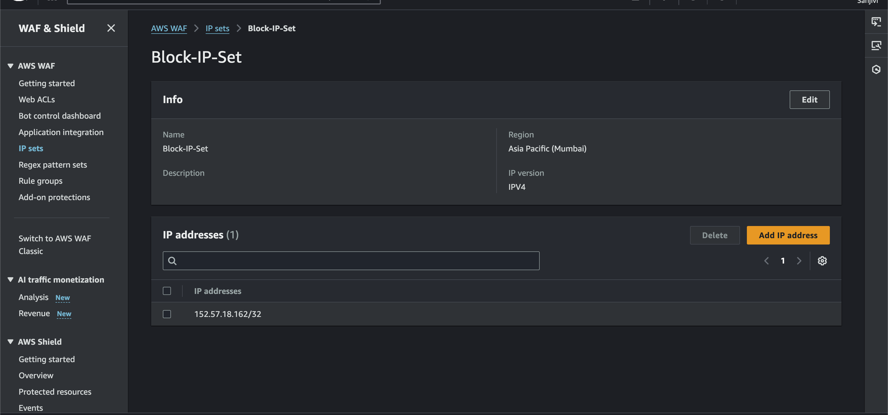

**2. WAF Rule Group**

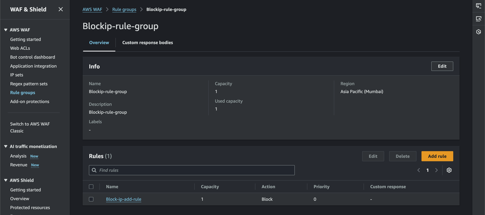

**3. WAF Web ACL IP Rule**

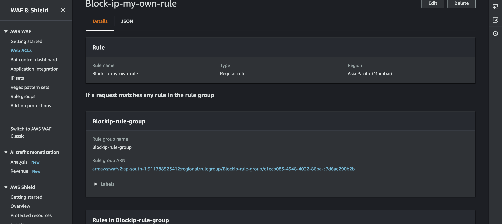

**4. IP Blocking Rule Details**

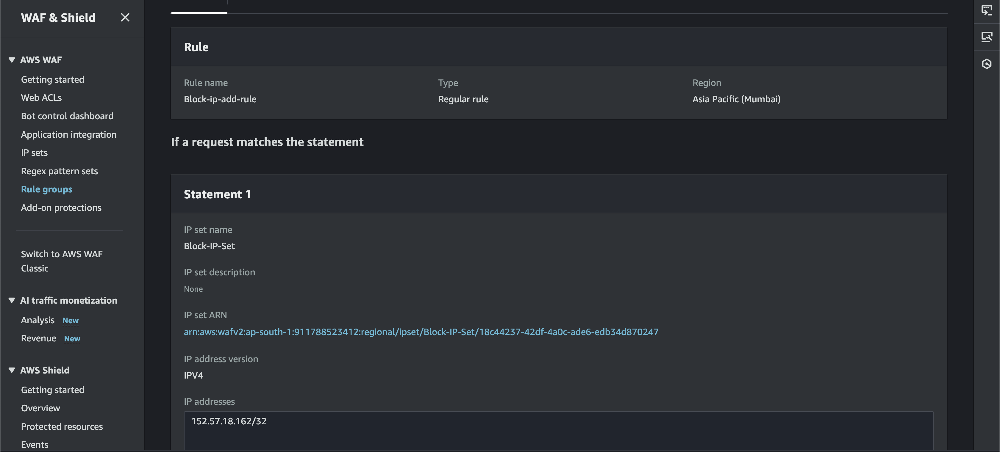

**5. WAF Web ACL Rules**

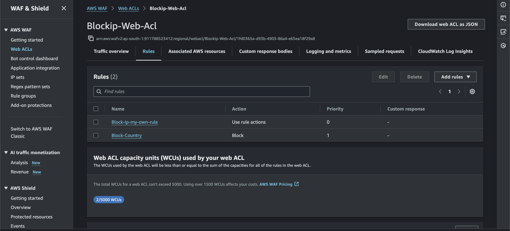

**6. WAF ALB Association**

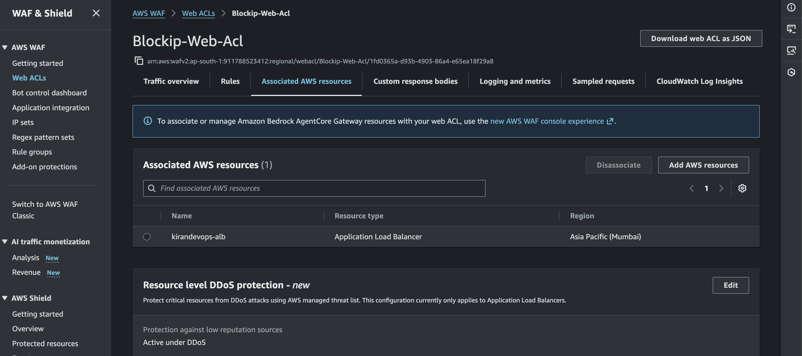

### WAF Testing

**7. IP Blocking – HTTP 403 Response**

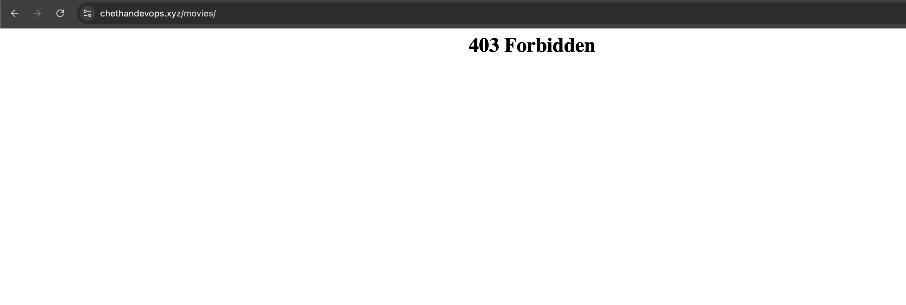

**8. Country Blocking Rule**

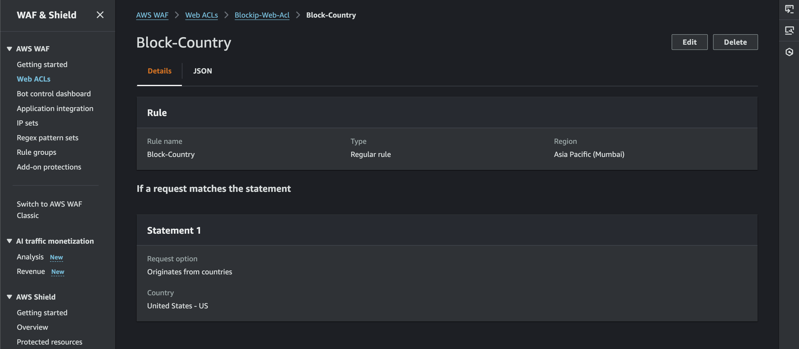

**9. WAF Web ACL All Rules**

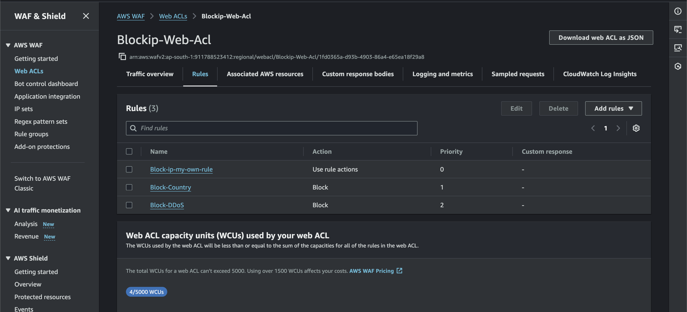

**10. Rate-Based Blocking Rule**

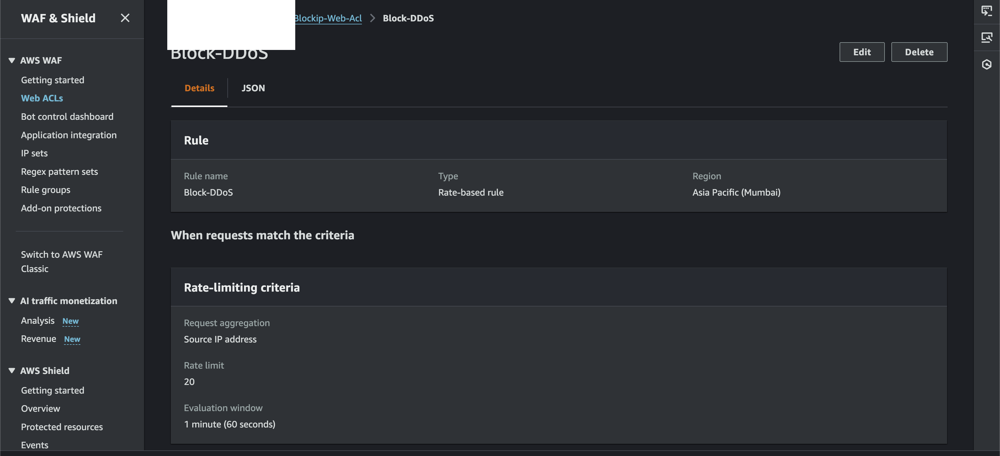

**11. Country Blocking Test from Virginia EC2**

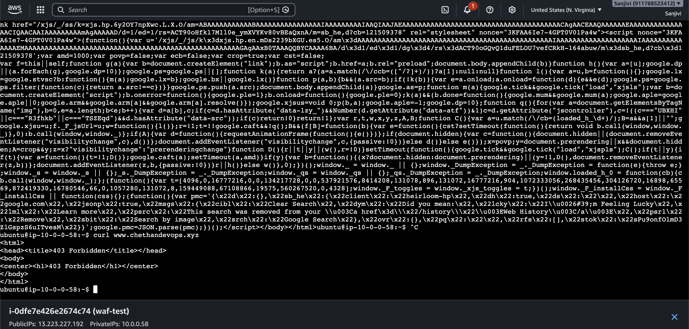

### Terraform and Application Testing

**12. Terraform Apply Error**

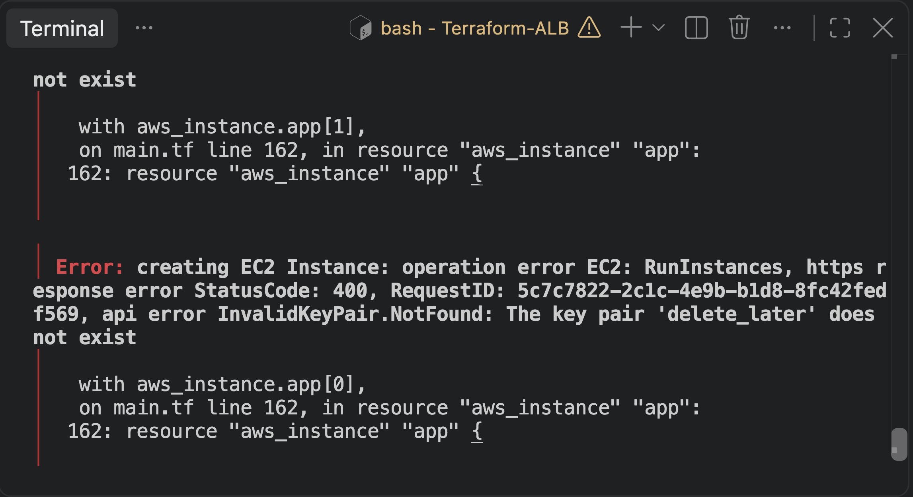

**13. Terraform Apply After Fix**

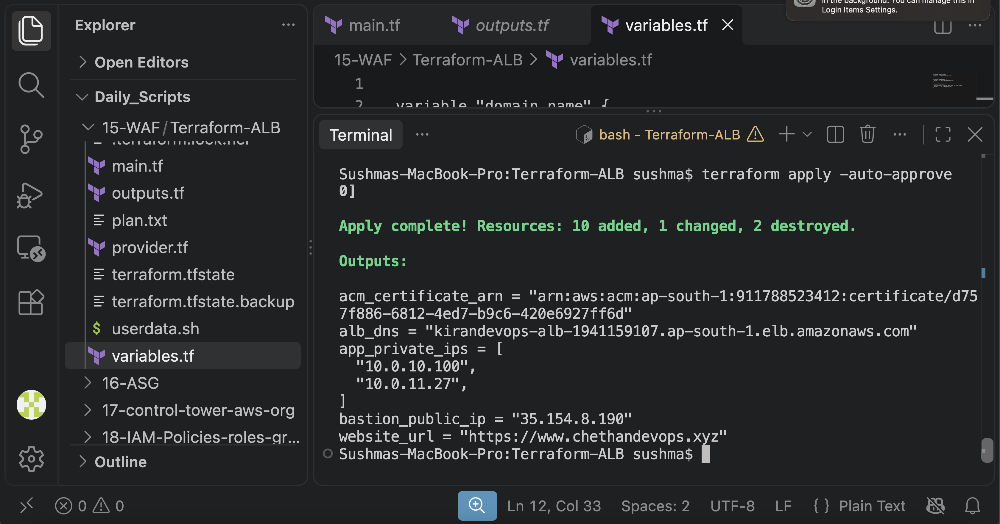

**14. Application – Movies Page**

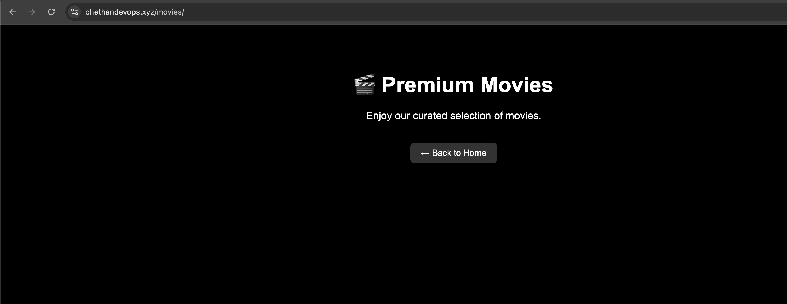

**15. Application – Shows Page**

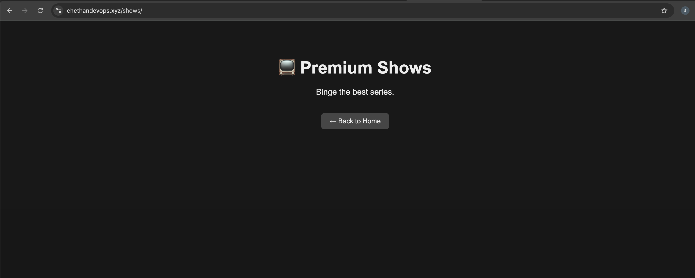

**16. Terraform Destroy Completed**

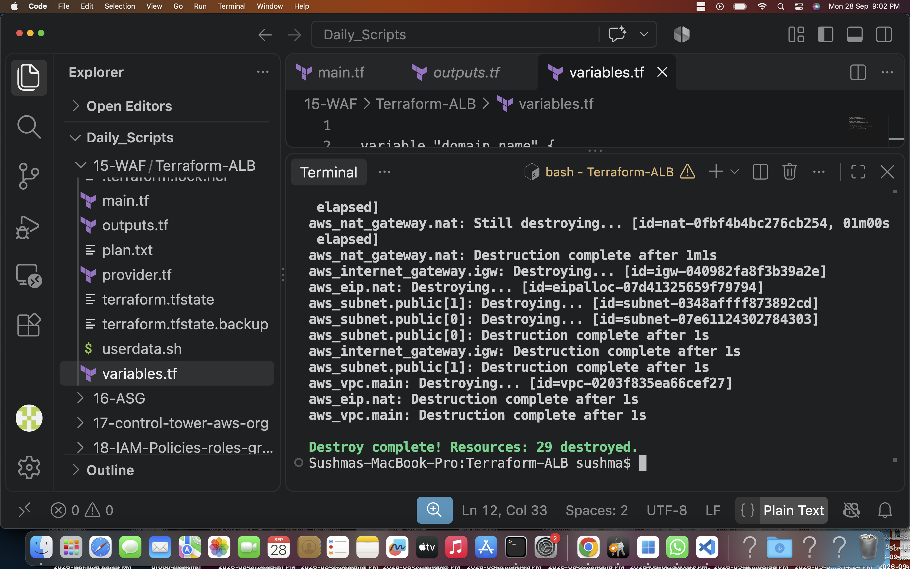

**17. Nginx Website Page**

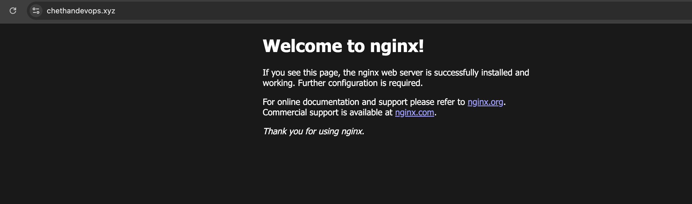

## Troubleshooting and Challenges

### 1. Terraform Apply Error

**Problem:**

During the Terraform deployment, the initial `terraform apply` operation encountered an error.

**What I did:**

1. Checked the Terraform apply output.
2. Reviewed the configuration after the error.
3. Corrected the configuration.
4. Ran Terraform apply again.
5. Verified the successful deployment.

**Result:**

Terraform successfully provisioned the infrastructure after the correction.

**Evidence:**
- `screenshots/11-Terraform-Apply-Error.png`
- `screenshots/12-Terraform-Apply-Fixed.png`

*The exact error message and the specific configuration change are not reproduced here because they need to be confirmed from the screenshots or Terraform configuration.*

### 2. IP Address Blocking Test

**Problem:**

The public IP address used during testing could change. If the current IP was not present in the WAF IP Set, the IP-blocking test would not behave as expected.

**How I handled it:**

1. Checked the current public IP address.
2. Opened the AWS WAF IP Set.
3. Updated the IP Set with the correct IPv4 address.
4. Used `/32` CIDR notation for the single IP.
5. Tested the website again.

**Validation command:**

```bash
curl -I https://www.chethandevops.xyz
```

**Observed response:**

```text
HTTP/2 403
```

### 3. Country-Based Blocking Test

**Problem:**

I needed to verify that the geographic rule was blocking requests from the configured country.

**How I tested it:**

1. Used an EC2 instance in Virginia (`us-east-1`).
2. Tested Google connectivity.
3. Accessed the application website.
4. Observed that Google was accessible while the application request was blocked.

**Result:**

The country-based blocking test behaved as expected.

### 4. Terraform and Manual AWS WAF Configuration

**Challenge:**

The main infrastructure was provisioned through Terraform, but AWS WAF was configured manually through the AWS Console.

**How I handled it:**

- Used Terraform for the main infrastructure.
- Configured the WAF IP Set, rule group, Web ACL, and rules manually.
- Associated the Web ACL with the ALB.
- Tested the rules independently.

**Learning:**

Resources created manually in the AWS Console are not automatically managed by Terraform. Infrastructure ownership and cleanup must be handled carefully.

### 5. Resource Cleanup

**Challenge:**

The project involved several billable AWS resources, including a NAT Gateway, EC2 instances, ALB, and other networking resources.

**How I handled it:**

1. Completed the application and WAF tests.
2. Ran `terraform destroy`.
3. Verified the Terraform destroy operation.
4. Remembered that manually created WAF resources need separate cleanup.

**Result:**

The Terraform-managed infrastructure was destroyed after testing.

## Security and Cost Considerations

- Use least-privilege security group rules in real environments.
- Avoid exposing private EC2 instances directly to the internet.
- Keep private application instances in private subnets.
- Use HTTPS for application access.
- Keep WAF IP Sets updated when the intended blocked IP changes.
- Monitor WAF metrics and logs to understand which rules are matching requests.
- A rate-based WAF rule provides request-rate protection but does not replace a complete DDoS protection strategy.
- Delete unused NAT Gateways, EC2 instances, ALBs, and other billable resources after lab testing.
- Review manually created WAF resources separately during cleanup.

## Key Learnings

Through this project, I learned:

1. How to create AWS infrastructure using Terraform.
2. How public and private subnets work together.
3. How Internet Gateway and NAT Gateway support network connectivity.
4. How an Application Load Balancer distributes incoming requests.
5. How HTTPS is configured using ACM.
6. How Route 53 routes domain traffic to an ALB.
7. How AWS WAF protects web applications.
8. How to create an IP Set and block a specific IP address.
9. How geographic match rules work.
10. How rate-based WAF rules help control excessive requests.
11. How to associate a Web ACL with an ALB.
12. How to test WAF blocking using HTTP responses.
13. How to troubleshoot Terraform deployment issues.
14. How to clean up AWS resources after completing a lab.

## Repository Structure

```text
aws-cloud-devops-hands-on/
│
└── Day-14-AWS-WAF-TERRAFORM-ALB/
    │
    ├── README.md
    ├── main.tf
    ├── variables.tf
    ├── outputs.tf
    ├── provider.tf
    ├── terraform.tfvars
    │
    └── screenshots/
        ├── architecture.png
        ├── 01-WAF-IP-Set.png
        ├── 02-WAF-Rule-Group.png
        ├── 02-WAF-Web-ACL-IP-Rule.png
        ├── 03-WAF-Block-IP-Rule-Details.png
        ├── 04-WAF-Web-ACL-Rules.png
        ├── 05-WAF-ALB-Association.png
        ├── 06-WAF-IP-Block-403-Test.png
        ├── 07-WAF-Block-Country-Rule.png
        ├── 08-WAF-Web-ACL-All-Rules.png
        ├── 09-WAF-Rate-Based-Block-DDoS-Rule.png
        ├── 10-WAF-Virginia-Country-Block-403.png
        ├── 11-Terraform-Apply-Error.png
        ├── 12-Terraform-Apply-Fixed.png
        ├── 13-Terraform-Website-Movies.png
        ├── 14-Terraform-Website-Shows.png
        ├── 15-Terraform-Destroy-Complete.png
        └── 16-Terraform-Website-Nginx-Page.png
```

*The Terraform filenames shown above are a suggested structure; keep the actual filenames from your project if they are different. Do not commit sensitive files such as `.pem` keys, credentials, or `terraform.tfstate`.*

## Conclusion

This project helped me understand how to provision AWS infrastructure using Terraform and protect a web application using AWS WAF.

I implemented IP-based blocking, country-based blocking, and rate-based protection. I also tested the blocking behavior through HTTP requests and a test EC2 instance located in another AWS region.

This hands-on project improved my understanding of AWS networking, load balancing, infrastructure as code, HTTPS, and web application security.

**Project completed as an individual hands-on learning project.**
