# Day 15: AWS Auto Scaling Group with ALB, CloudWatch and SNS

## 1. Project Overview

In this individual AWS hands-on project, I configured an Auto Scaling Group (ASG) with a custom Amazon Machine Image (AMI), EC2 Launch Template, Application Load Balancer (ALB), Target Group, CloudWatch alarms, dynamic scaling policies, and SNS email notifications.

**Project details**
- **AWS Region:** `us-east-1` (US East — N. Virginia)
- **Auto Scaling Group:** `ASG-ASG`
- **Launch Template:** `ASG-Launch-Template-v1`
- **Application Load Balancer:** `ASG-ALB`
- **SNS Topic:** `ASG-SNS`
- **Custom AMI:** `ami-0fea81bbb97f92bb5`
- **Minimum capacity:** 1
- **Initial desired capacity:** 1
- **Maximum capacity:** 4

## 2. Architecture Flow

### Application Traffic Flow

```text
                   Users
                     |
                     v
          Application Load Balancer
                  ASG-ALB
                     |
                     v
                Target Group
                     |
          +----------+----------+
          |          |          |
          v          v          v
        EC2-1      EC2-2      EC2-N
          |          |          |
          +----------+----------+
                     |
                     v
            Auto Scaling Group
                 ASG-ASG
```

### Instance Provisioning Flow

```text
Custom AMI
    |
    v
EC2 Launch Template
ASG-Launch-Template-v1
    |
    v
Auto Scaling Group
    |
    v
Launch EC2 Instances
    |
    v
Register Instances with Target Group
    |
    v
ALB Health Checks
    |
    v
Healthy Targets Receive Traffic
```

### CloudWatch Scaling Flow

```text
EC2 CPU Utilization
        |
        v
 Amazon CloudWatch
        |
   +----+----+
   |         |
   v         v
Scale-Out  Scale-In
CPU > 40%  CPU < 35%
   |         |
   v         v
Dynamic Scaling Policies
        |
        v
Auto Scaling Group
        |
        v
Adjust EC2 Capacity
```

### SNS Notification Flow

```text
Auto Scaling Group Events
           |
           v
        Amazon SNS
         ASG-SNS
           |
           v
      Email Notification
           |
           v
   Confirmed Subscription
```

## 3. AWS Services Used

| Service | Purpose |
|---|---|
| Amazon EC2 | Runs virtual machine instances |
| Custom AMI | Provides a reusable machine image |
| Launch Template | Defines EC2 launch settings |
| Auto Scaling Group | Maintains and adjusts EC2 capacity |
| Application Load Balancer | Distributes application traffic |
| Target Group | Registers instances and checks health |
| CloudWatch | Monitors CPU utilization and evaluates alarms |
| Dynamic Scaling Policies | Adjust capacity according to configured conditions |
| Amazon SNS | Sends email notifications |

## 4. Step-by-Step Implementation

### Step 1: Created a Custom AMI

I created a custom Amazon Machine Image to use as the base image for launching EC2 instances.

**Why:** A custom AMI helps launch instances from a prepared image instead of repeating the same setup manually.

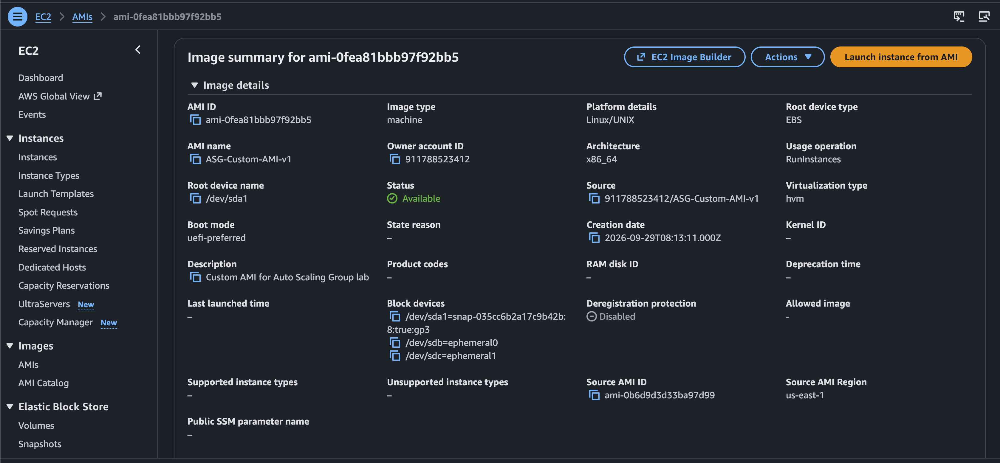

### Step 2: Created the EC2 Launch Template

I configured `ASG-Launch-Template-v1` using my custom AMI and the required EC2 launch settings.

**Why:** The Auto Scaling Group uses the launch template to create new instances with consistent settings.

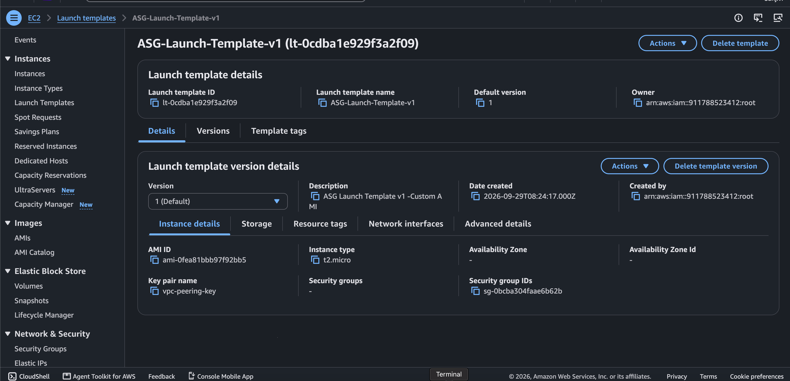

### Step 3: Configured the Application Load Balancer

I configured the Application Load Balancer named `ASG-ALB`.

**Why:** The ALB provides a single entry point and distributes incoming application requests to registered targets.

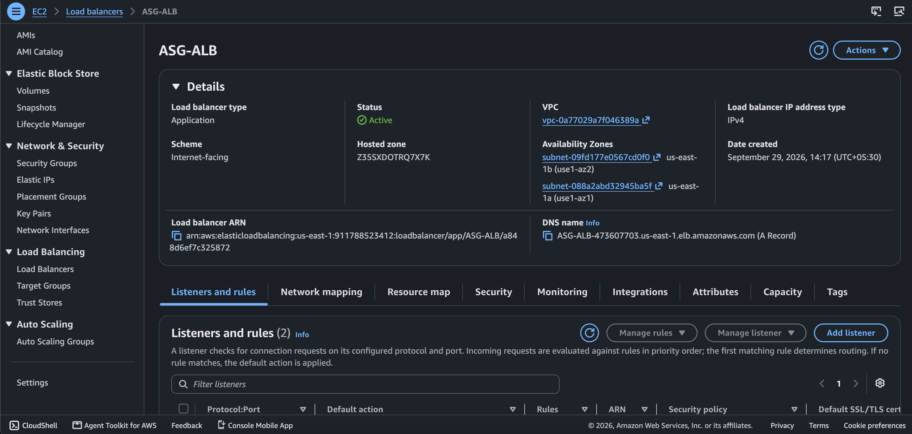

### Step 4: Configured the Target Group

I configured the target group and checked the health status of registered targets.

**Why:** Health checks help the ALB determine whether an instance is healthy enough to receive traffic.

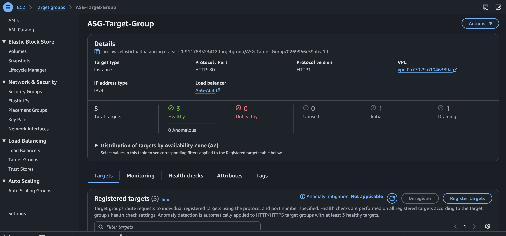

### Step 5: Configured the Auto Scaling Group

I configured the Auto Scaling Group named `ASG-ASG` to use my launch template and the required networking and load-balancing settings.

Capacity configuration:
- Minimum: 1 instance
- Desired: 1 instance initially
- Maximum: 4 instances

I also configured dynamic scaling policies using CloudWatch CPU utilization alarms.

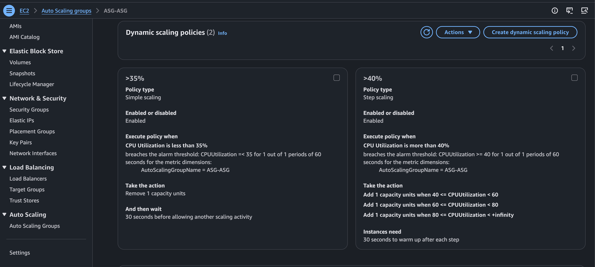

### Step 6: Configured CloudWatch Alarms

The lab's configured thresholds were:
- Scale-out alarm: CPU utilization above `40%`
- Scale-in alarm: CPU utilization below `35%`

**Scale-out** can increase capacity when its conditions are met. **Scale-in** can reduce capacity when its conditions are met.

The actual scaling action also depends on alarm evaluation settings, scaling policy configuration, and ASG capacity limits.

### Step 7: Tested Scale-Out

I generated CPU load using the `stress` utility:

```bash
stress --cpu 1
```

I monitored CPU utilization and CloudWatch alarm states. During the test, the activity history recorded capacity increases from `1 → 2`, `2 → 3`, and `3 → 4`.

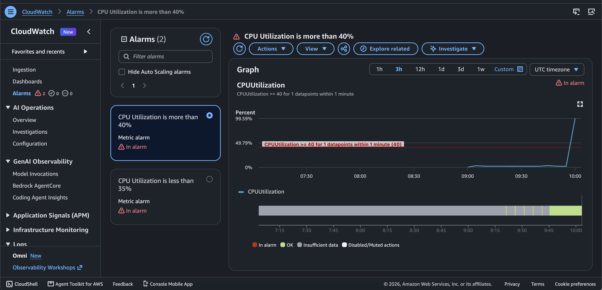

### Step 8: Tested Scale-In

I monitored the scale-in alarm and Auto Scaling activity history when CPU utilization changed.

The activity history recorded a capacity reduction from `4 → 3`.

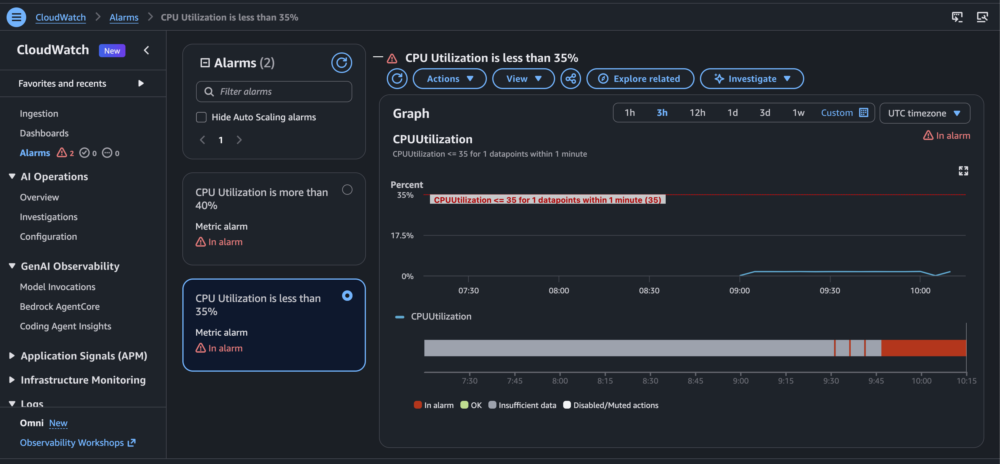

### Step 9: Verified EC2 Instances

I checked the EC2 console to observe the instances involved in the scaling test.

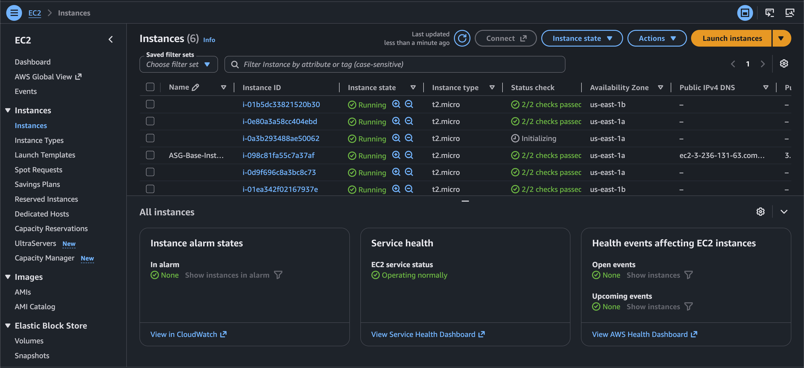

### Step 10: Reviewed Scaling Activity History

I reviewed the Auto Scaling activity history to understand the capacity changes and whether the actions succeeded.

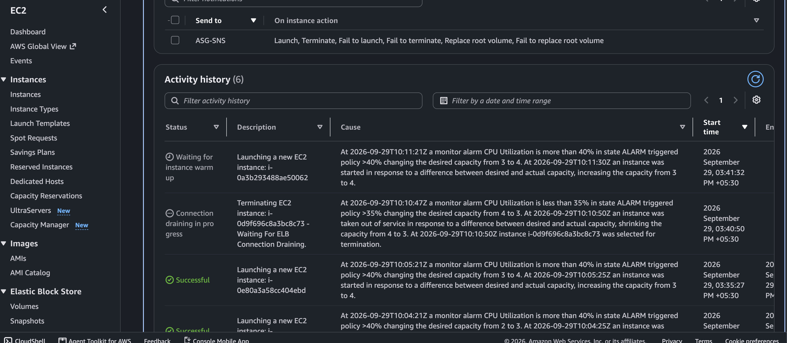

### Step 11: Verified Successful Scale-Out Activity

I checked the activity history for successful scale-out events. During testing, CPU utilization fluctuated and another scale-out event occurred after a scale-in.

**Learning:** Scaling behavior depends on changing metrics, alarm evaluation, scaling policies, and capacity limits.

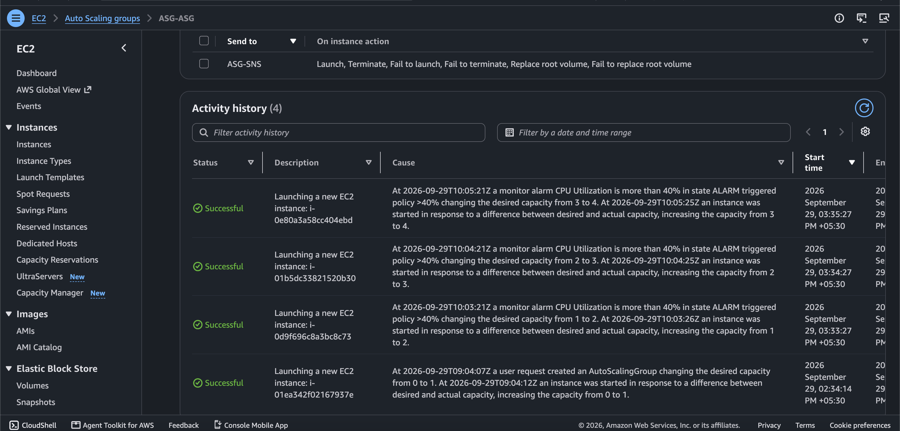

### Step 12: Checked the Final ASG State

I reviewed the Auto Scaling Group instance-management view after the scaling tests.

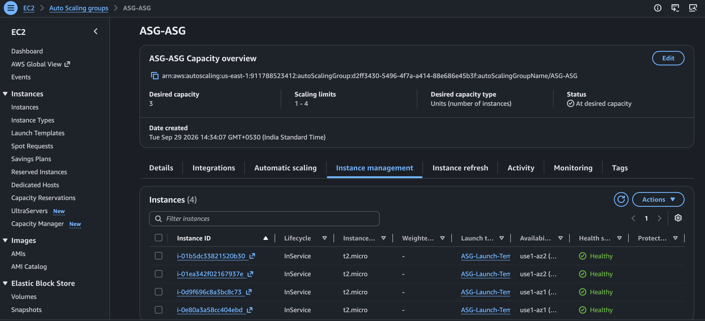

### Step 13: Configured SNS Email Notifications

I configured the SNS topic named `ASG-SNS` for Auto Scaling Group event notifications.

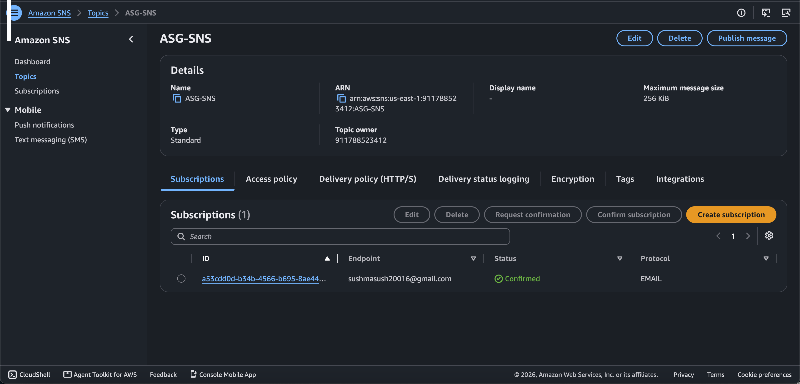

### Step 14: Confirmed the SNS Subscription

I confirmed the SNS email subscription so that notifications could be delivered to the subscribed email address.

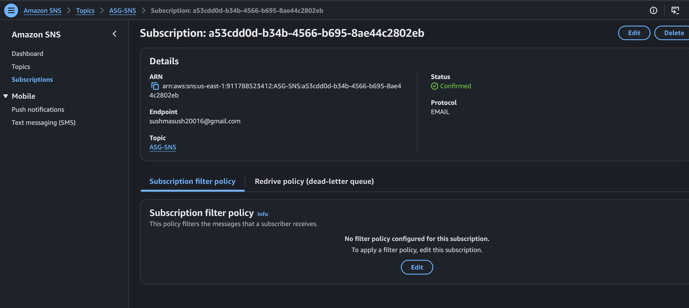

## 5. Troubleshooting and Fixes

### Issue 1: CloudWatch Alarm Evaluation Timing

**What I observed:** I initially used a short alarm period while configuring the CPU alarms.

**Fix:** I changed the alarm period to one minute to make the evaluation interval more suitable for observing the lab's scaling behavior.

**Learning:** Alarm period, evaluation periods, and datapoints to alarm affect when an alarm changes state.

### Issue 2: Scale-Out and Scale-In Both Occurred

**What I observed:** The Auto Scaling Group scaled out, later scaled in, and scaled out again when CPU conditions changed.

**Investigation:** I checked CloudWatch alarm states and Auto Scaling activity history.

**Learning:** Dynamic scaling reacts to changing metrics. CPU fluctuations can lead to additional scaling actions when configured conditions are met.

### Issue 3: Verifying Successful Scaling

A CloudWatch alarm changing state alone does not prove that instances launched successfully or became healthy.

I checked the ASG activity history, EC2 instances, and target group health information.

**Troubleshooting flow:**

```text
CPU Metric
    |
    v
CloudWatch Alarm
    |
    v
Scaling Policy
    |
    v
ASG Activity History
    |
    v
EC2 Instance State
    |
    v
Target Group Health
```

### Future Troubleshooting Checklist

1. Check whether the expected CloudWatch alarm is in `ALARM` state.
2. Verify that CPU utilization meets the configured threshold.
3. Check whether the scaling policy is attached to the correct alarm.
4. Confirm that the ASG has not reached its minimum or maximum capacity.
5. Review ASG activity history for successful actions or errors.
6. Verify the launch template and AMI.
7. Check networking and security group rules.
8. Verify target group health checks.
9. Confirm the SNS subscription and notification configuration.

This checklist includes additional checks for future troubleshooting; it does not mean every listed issue occurred in this project.

## 6. Important Concepts Learned

- **AMI:** A reusable image used to launch EC2 instances.
- **Launch Template:** A reusable EC2 launch configuration.
- **Auto Scaling Group:** Maintains EC2 capacity within configured limits.
- **Application Load Balancer:** Distributes application requests.
- **Target Group:** Registers targets and performs health checks.
- **CloudWatch Alarm:** Changes state when configured metric conditions are met.
- **Dynamic Scaling Policy:** Adjusts capacity according to scaling conditions.
- **SNS:** Sends notifications to subscribed endpoints.
- **Activity History:** Helps investigate scaling actions and errors.

## 7. Cost Optimization and Cleanup

This is a learning lab. Review and remove unused resources after testing to avoid unnecessary AWS charges.

1. Save the screenshots and documentation.
2. Review the Auto Scaling Group and related load balancer resources.
3. Delete the Auto Scaling Group when it is no longer needed.
4. Delete the load balancer and target group if they are no longer used.
5. Check for leftover EC2 instances, EBS volumes, snapshots, Elastic IP addresses, and NAT Gateways.
6. Keep the custom AMI only if needed for future practice. Its backing snapshots can incur storage charges.
7. Verify in the AWS console that unwanted resources have been removed.

**Important:** Deleting an Auto Scaling Group can terminate instances managed by it, depending on its deletion and termination settings. Confirm that you do not need to retain the resources before deleting them.

## 8. Project Evidence

The `screenshots/` directory contains 13 screenshots embedded in the implementation steps above. They document the custom AMI, launch template, ALB, target group health checks, scaling policies, CloudWatch alarms, EC2 instances, activity history, and SNS notifications.

## 9. Final Outcome

Through this individual hands-on project, I practiced creating a reusable EC2 image, configuring a launch template, integrating an Auto Scaling Group with an Application Load Balancer, testing CloudWatch-based dynamic scaling, reviewing activity history, and configuring SNS email notifications.

This project improved my understanding of EC2 capacity management, load balancing, monitoring, scaling behavior, and AWS troubleshooting.

**Project type:** Individual AWS hands-on learning project.

