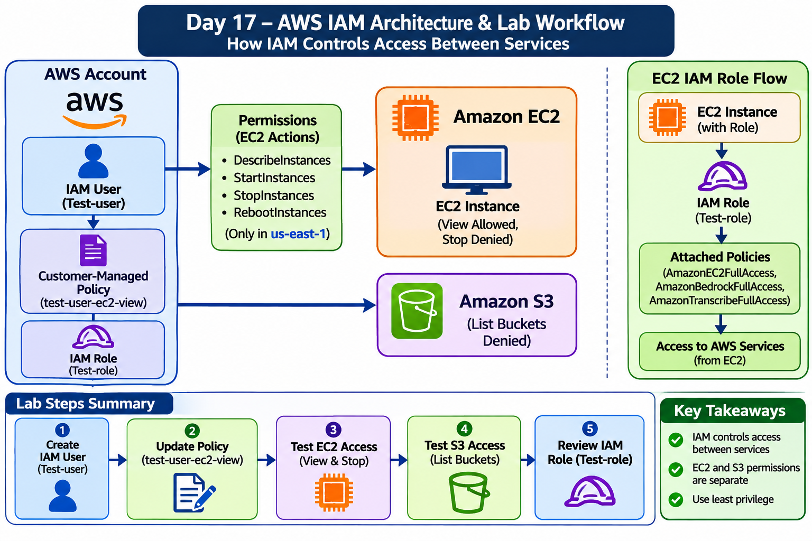
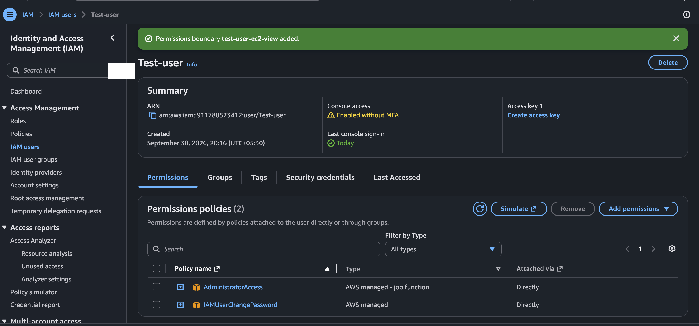
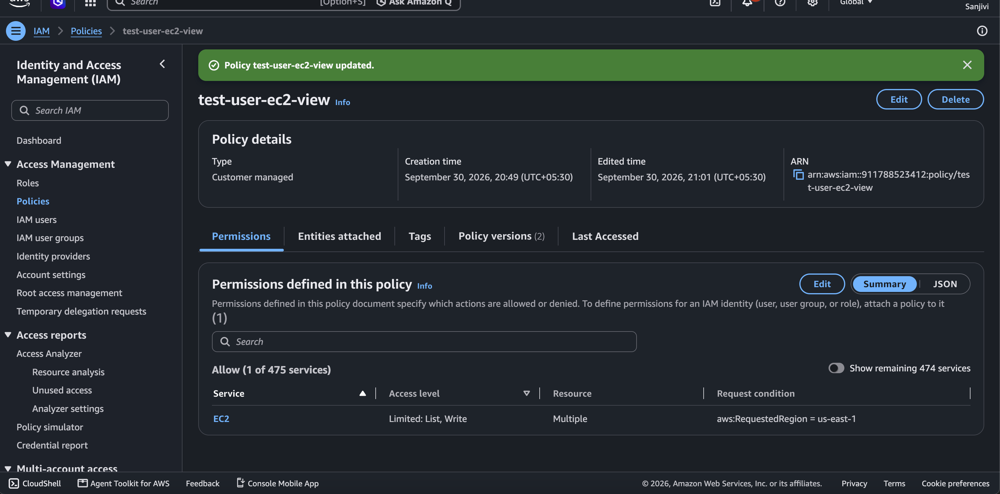
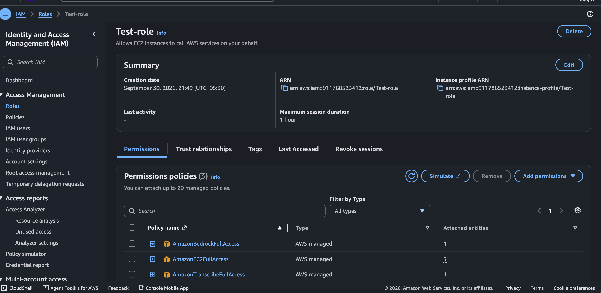
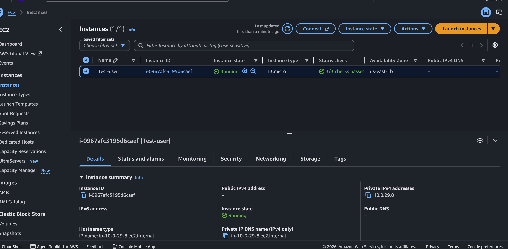
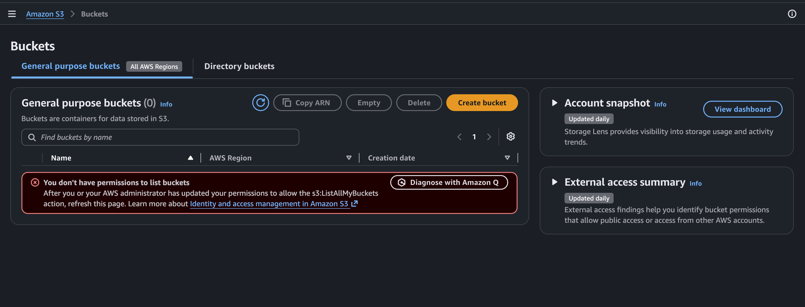
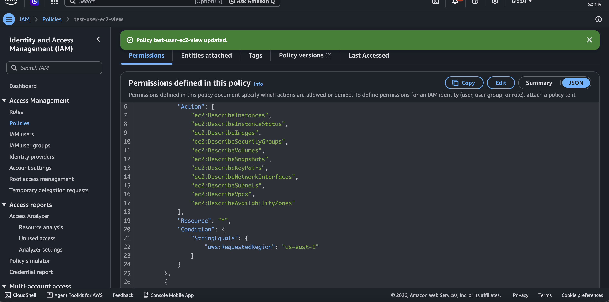
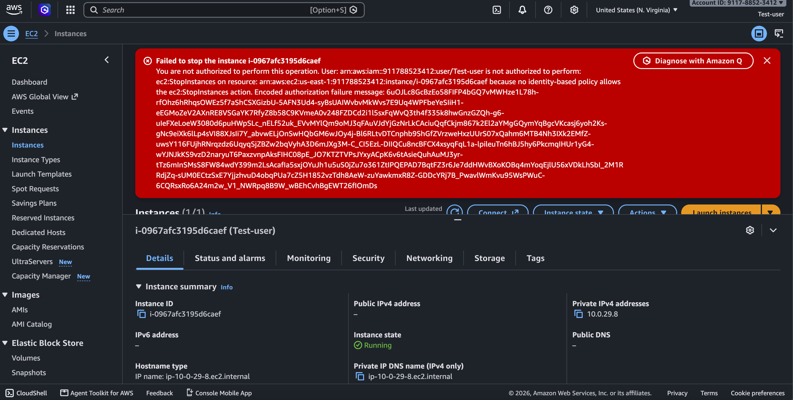

# Day 17 – AWS IAM (Identity and Access Management)

## 1. Project Overview

This project demonstrates how AWS Identity and Access Management (IAM) controls access to AWS resources using IAM users, roles, and policies.

In this hands-on project, I created an IAM user, updated an existing customer-managed policy, reviewed IAM policy JSON, tested EC2 permissions, tested S3 access, and reviewed an EC2 IAM role.

The main objective was to understand how AWS controls access to resources and how IAM permissions determine whether an operation is allowed or denied.

**Project Type:** Individual Hands-on Project  
**AWS Service:** IAM  
**EC2 Testing Region:** us-east-1

## 2. Project Objectives

- Understand IAM users, roles, and policies.
- Create an IAM user with console access.
- Understand customer-managed IAM policies.
- Review IAM policy JSON structure.
- Understand EC2 permissions and resource restrictions.
- Test allowed and denied IAM actions.
- Understand why EC2 permissions do not automatically grant S3 access.
- Review an IAM role configured for EC2.
- Understand the principle of least privilege.
- Troubleshoot IAM AccessDenied errors.

## 3. AWS Services and Components Used

| Component | Purpose |
|---|---|
| AWS IAM | Manage identities and permissions |
| IAM User | Test AWS console access |
| IAM Policy | Define allowed AWS actions |
| IAM Role | Provide permissions to a trusted AWS service |
| Amazon EC2 | Test instance viewing and stopping permissions |
| Amazon S3 | Test bucket-listing permissions |

## 4. AWS IAM Architecture Diagram

The architecture diagram represents the IAM user, customer-managed policy, EC2 and S3 permission testing, and the separate EC2 IAM role used in this project.

**Architecture Image:**

*

## 5. Architecture Workflow Explanation

### Main Workflow – IAM User and Policy

**Step 1: AWS Account**

The AWS account contains IAM identities and AWS resources. IAM controls who can access AWS services and which actions they can perform.

**Step 2: Create IAM User – Test-user**

Created an IAM user named `Test-user` and enabled AWS Management Console access.

This user was used to test different AWS permissions.

**Step 3: Attach and Update Customer-Managed Policy**

Worked with the existing customer-managed policy named `test-user-ec2-view`.

The policy defined EC2 permissions, including:
- EC2 Describe actions.
- Region restriction for `us-east-1`.
- Resource restrictions for applicable EC2 instance actions.

**Step 4: EC2 Permission Testing**

Logged in using `Test-user` and opened the EC2 console.

Two operations were tested:

- **View EC2 instance:** Successfully viewed EC2 instance information.
- **Stop EC2 instance:** Received an AccessDenied error.

**Step 5: S3 Permission Testing**

Using the same IAM user, attempted to list S3 buckets.

AWS returned AccessDenied because the required `s3:ListAllMyBuckets` permission was not available.

This demonstrated that EC2 permissions do not automatically provide S3 permissions.

### Separate Workflow – IAM Role

**Step 6: Review IAM Role – Test-role**

Reviewed the IAM role named `Test-role`.

- EC2 was selected as the trusted service use case.
- Reviewed the attached managed policies.
- Understood how EC2 can assume an IAM role to access permitted AWS services using temporary credentials.

**Important:** `Test-role` and `Test-user` are separate IAM identities. The role's permissions are not automatically granted to the IAM user.

### Overall Architecture Flow

**IAM User Workflow:**

AWS Account → IAM User (`Test-user`) → Customer-Managed Policy → EC2/S3 Permission Evaluation → Allowed or AccessDenied.

**IAM Role Workflow:**

EC2 Instance → IAM Role → Attached IAM Policies → Access to Permitted AWS Services.

## 6. Step-by-Step Implementation

### Step 1: Create an IAM User

Created an IAM user named `Test-user`.

Activities:
- Opened AWS IAM.
- Created the IAM user.
- Enabled AWS Management Console access.
- Used the user to test AWS permissions.

### Step 2: Update the Customer-Managed Policy

Worked with the existing customer-managed policy:

`test-user-ec2-view`

Reviewed and updated the policy to define EC2 access.

The policy included:
- EC2 Describe permissions.
- Region restriction for `us-east-1`.
- Resource restrictions for applicable EC2 instance actions.
- Additional EC2 action permissions defined in the policy.

### Step 3: Review IAM Policy JSON

Reviewed the policy JSON and understood its main elements.

| JSON Element | Meaning |
|---|---|
| Version | IAM policy language version |
| Statement | Permission statement |
| Effect | Allow or Deny |
| Action | AWS API operation |
| Resource | AWS resource affected |
| Condition | Additional permission conditions |

A policy condition can restrict requests to a particular AWS Region.

### Step 4: Test EC2 Access Using Test-user

Activities:
- Logged in using the `Test-user` IAM account.
- Opened the EC2 console.
- Selected the permitted Region, `us-east-1`.
- Viewed EC2 instance information.

**Result:** EC2 instance viewing was successful.

### Step 5: Test S3 Access

Activities:
- Opened the Amazon S3 console using `Test-user`.
- Attempted to list S3 buckets.
- AWS returned an AccessDenied error.
- Identified that the required `s3:ListAllMyBuckets` permission was not available.

**Result:** S3 bucket listing was denied.

### Step 6: Review the IAM Role

Reviewed the IAM role named `Test-role`.

Observed:
- EC2 was selected as the trusted service use case.
- The role had the following managed policies attached:
  - `AmazonBedrockFullAccess`
  - `AmazonEC2FullAccess`
  - `AmazonTranscribeFullAccess`

These are broad permissions used in this lab. Production workloads should use narrowly scoped permissions following the principle of least privilege.

## 7. Troubleshooting and Findings

### Issue 1: EC2 Stop Operation Returned AccessDenied

**What I did:**

1. Logged in as `Test-user`.
2. Opened the EC2 console.
3. Selected the EC2 instance.
4. Attempted to stop the instance.
5. AWS returned an AccessDenied error.

**What I investigated:**

- Reviewed the custom IAM policy.
- Checked the EC2 action permissions.
- Understood that the effective permissions did not authorize `ec2:StopInstances`.

**Root Cause / Finding:**

The Stop operation was not authorized for this request under the effective IAM permissions.

IAM authorization depends on applicable identity policies, resource scope, conditions, and other permission controls.

**Resolution / Learning:**

Identified that an applicable `ec2:StopInstances` Allow permission was needed, satisfying the resource and condition restrictions.

I retained the denied result as evidence of permission testing. The Stop operation was not claimed as fixed.

### Issue 2: S3 Bucket Listing Returned AccessDenied

**What I did:**

1. Logged in as `Test-user`.
2. Opened Amazon S3.
3. Attempted to list buckets.
4. Received an AccessDenied error.

**Root Cause / Finding:**

The user did not have the required `s3:ListAllMyBuckets` permission.

**Resolution / Learning:**

Identified the missing permission needed for bucket listing.

The lab demonstrated that permissions for EC2 do not automatically grant permissions for S3.

The denied result was retained as evidence. No S3 permission change was claimed.

## 8. Permission Testing Results

| IAM Identity | AWS Operation | Observed Result |
|---|---|---|
| Test-user | View EC2 instance information | Allowed |
| Test-user | Stop EC2 instance | AccessDenied |
| Test-user | List S3 buckets | AccessDenied |
| Test-role | Review EC2 service role configuration | Successful |

## 9. Important IAM Concepts Learned

### IAM User
An identity used by a person or application to access AWS.

### IAM Policy
A JSON document that defines which AWS actions are allowed or denied.

### IAM Role
An identity assumed by a trusted user, service, or application to obtain temporary credentials and permissions.

### Least Privilege
Grant only the permissions required to perform a specific task.

### AccessDenied
An AccessDenied error means the requested operation was not authorized. It can result from missing Allow permissions, explicit Deny statements, conditions, resource restrictions, or other applicable permission controls.

### Region Restriction
IAM policy conditions can restrict actions to a specified AWS Region.

## 10. Real-World Scenario

Consider an EC2 instance running an application that needs access to an S3 bucket.

Instead of storing AWS access keys inside the EC2 instance:

1. Create an IAM role.
2. Configure EC2 as the trusted service.
3. Attach a least-privilege IAM policy to the role.
4. Allow only the required S3 actions on the required bucket.
5. Associate the role with the EC2 instance.
6. Let the application obtain temporary credentials through the instance role.

This is safer than storing long-term access keys inside application code.

## 11. Security Best Practices

- Follow the principle of least privilege.
- Avoid attaching broad managed policies unnecessarily.
- Do not share IAM user passwords.
- Do not store AWS access keys in source code.
- Use IAM roles for AWS workloads whenever possible.
- Review policy Resource and Condition restrictions.
- Enable MFA for human users where appropriate.
- Regularly review unused permissions.

## 12. Screenshots and Evidence

All practical screenshots are stored in the `screenshots/` folder.

### 1. IAM Test User Created

### 2. Customer-Managed EC2 Policy Updated

### 3. IAM EC2 Role and Attached Permissions

### 4. Test-user EC2 Instance Access Successful

### 5. Test-user S3 Bucket Access Denied

### 6. Customer-Managed IAM Policy JSON

### 7. Test-user EC2 Stop Access Denied

## 13. Project Outcome

Through this hands-on project, I learned how AWS IAM controls access to AWS resources.

I created an IAM user, updated and reviewed a customer-managed policy, tested EC2 and S3 permissions, reviewed an EC2 service role, and investigated AccessDenied errors.

The lab helped me understand the difference between IAM users, IAM roles, and IAM policies, along with how permissions are evaluated when a user accesses AWS services.

## 14. Conclusion

This project provided practical experience with AWS Identity and Access Management.

I gained hands-on understanding of identity management, policy structure, EC2 access control, S3 permissions, role-based access, and IAM troubleshooting.

**Project completed as an individual AWS Cloud and DevOps hands-on learning project.**
