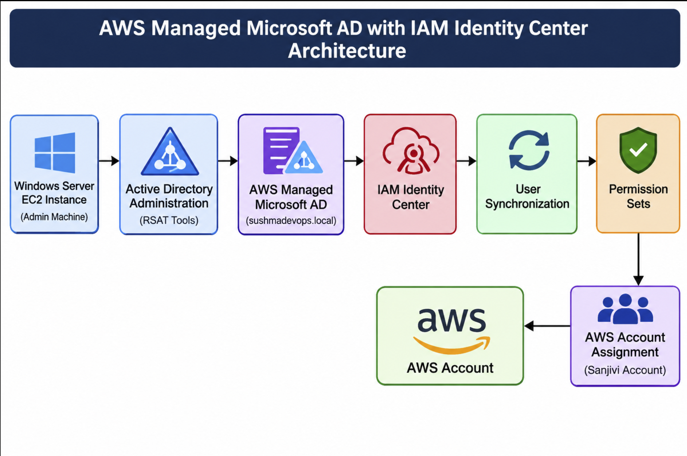
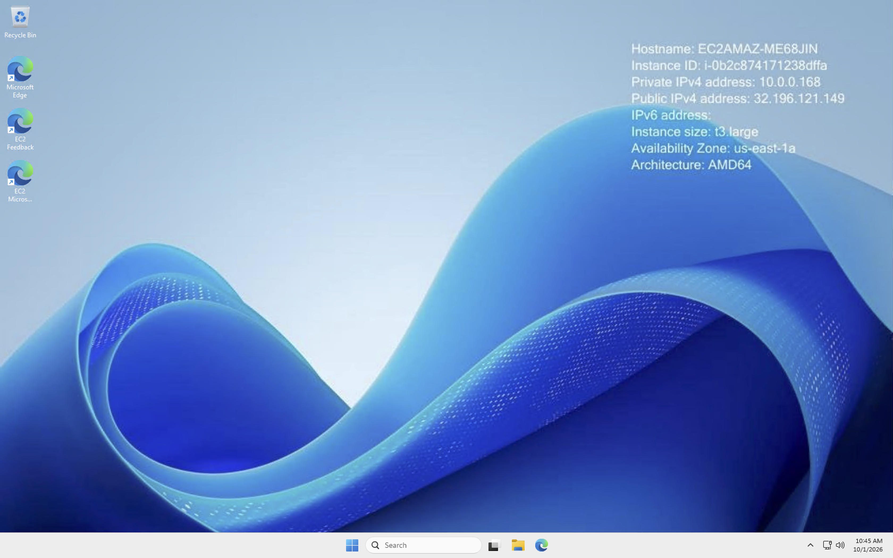
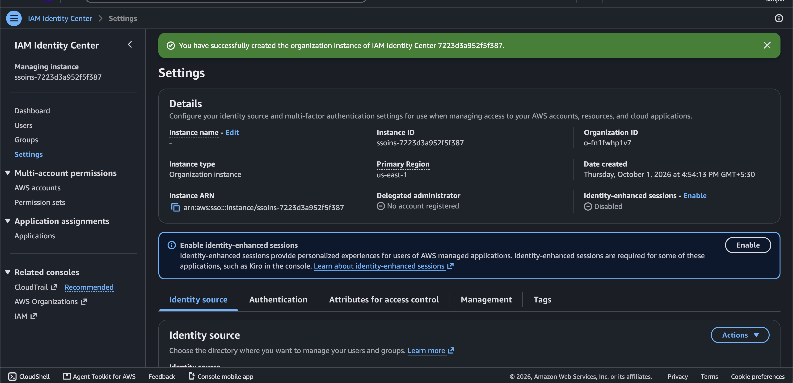
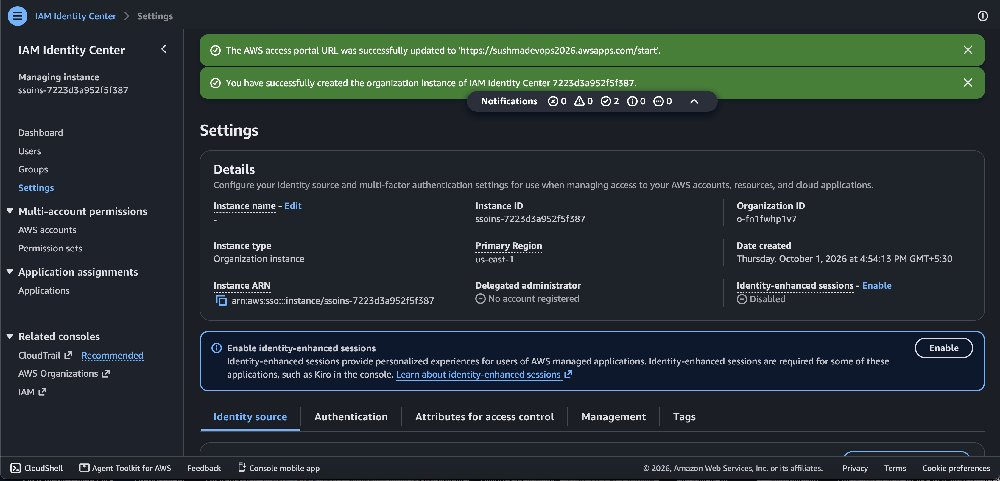
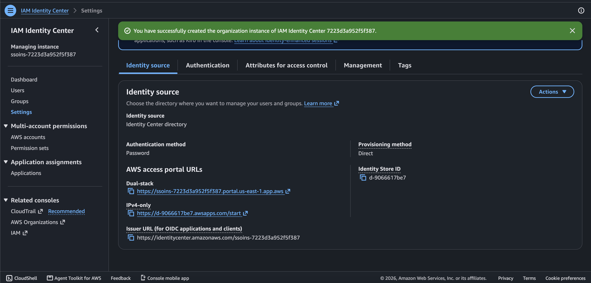
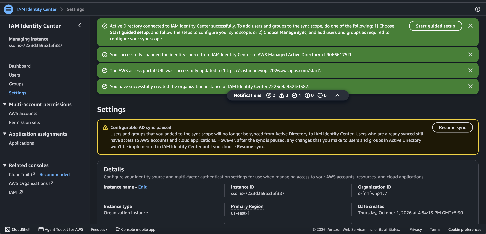
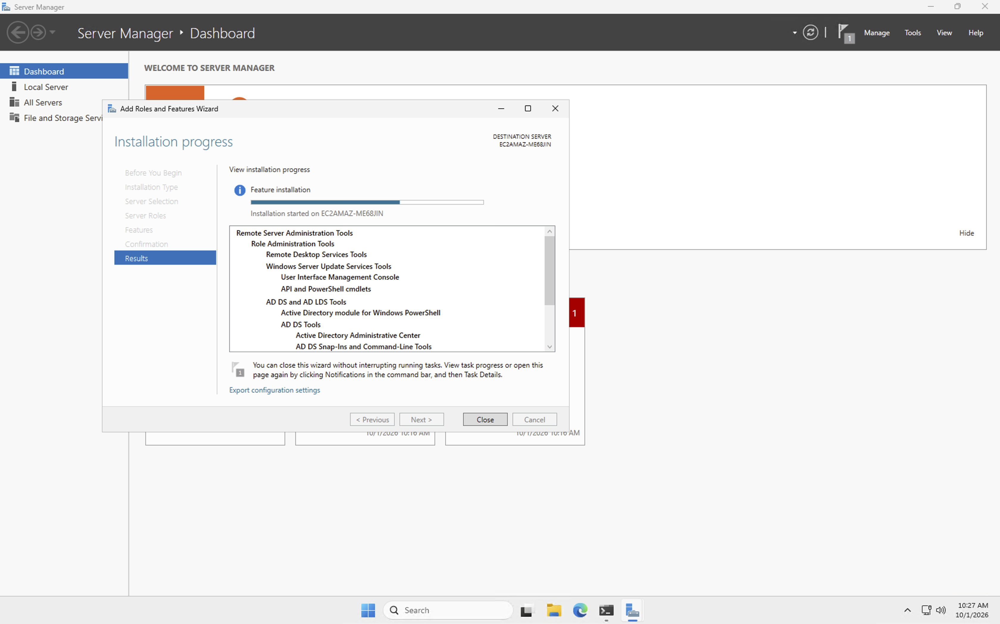
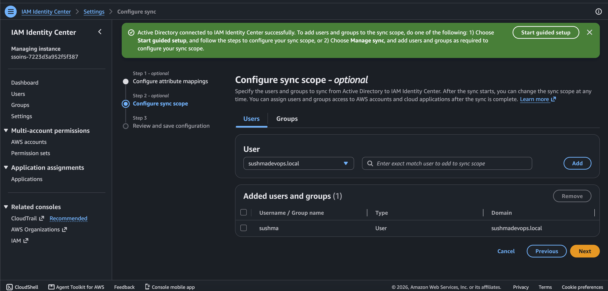

# Day 18 – AWS Managed Microsoft AD with IAM Identity Center

## 1. Project Overview

In this individual hands-on project, I configured **AWS Managed Microsoft AD and integrated it with AWS IAM Identity Center** to understand centralized identity management and AWS account access.

I used a Windows Server EC2 instance to administer Active Directory through Remote Server Administration Tools (RSAT).

I configured an AWS Managed Microsoft AD directory with the domain `sushmadevops.local`, created Active Directory users, connected the directory to IAM Identity Center, and configured user synchronization.

I also worked with permission sets and AWS account assignments to understand how directory users can be given access to AWS accounts.

**Project Details**

- Project: AWS Managed Microsoft AD Integration with IAM Identity Center
- Region: us-east-1
- Directory domain: sushmadevops.local
- Windows Server: EC2
- Identity source: AWS Managed Microsoft AD
- Identity management: AWS IAM Identity Center

## 2. Architecture Flow

```text
             Windows Server EC2
                     |
                     v
             Install RSAT Tools
                     |
                     v
         Active Directory Administration
                     |
                     v
          AWS Managed Microsoft AD
                     |
                     v
          Domain: sushmadevops.local
                     |
                     v
           Active Directory Users
                     |
                     v
           AWS IAM Identity Center
                     |
                     v
             Identity Source
               Integration
                     |
                     v
             User Synchronization
                     |
                     v
               Permission Sets
                     |
                     v
             AWS Account Assignment
                     |
                     v
                AWS Account
```

## 3. Architecture Diagram

The following diagram illustrates how the AWS services and components are connected in this project.



## 4. Services and Components Used

| Service / Component | Purpose |
| ------------------- | ------- |
| Amazon EC2 | Windows Server for Active Directory administration |
| AWS Managed Microsoft AD | Managed Microsoft Active Directory directory |
| RSAT | Active Directory administration tools |
| Active Directory | Domain and user management |
| IAM Identity Center | Centralized workforce access management |
| Identity Source | Connects the directory to IAM Identity Center |
| User Synchronization | Makes selected directory users available in IAM Identity Center |
| Permission Sets | Defines AWS account permissions |
| AWS Account Assignment | Assigns users and permission sets to an AWS account |

## 5. Implementation – What I Did

### Step 1: Windows Server EC2 Setup

- Launched a Windows Server EC2 instance.
- Connected to the Windows Server.
- Used it as the administration machine for Active Directory.

### Step 2: AWS Managed Microsoft AD

- Opened AWS Directory Service.
- Created an AWS Managed Microsoft AD directory.
- Configured the domain name `sushmadevops.local`.
- Waited for directory creation to complete.

### Step 3: Install Active Directory Tools

- Opened Server Manager.
- Selected Add Roles and Features.
- Installed Remote Server Administration Tools (RSAT).
- Installed the Active Directory administration tools.
- Used the tools to access and manage Active Directory.

### Step 4: Active Directory User Management

- Opened Active Directory Users and Computers.
- Accessed the managed domain.
- Viewed the domain structure.
- Created directory users for the lab.

Users configured:

- `sushma@sushmadevops.local`
- `sushmatest2@sushmadevops.local`

### Step 5: IAM Identity Center Setup

- Opened AWS IAM Identity Center.
- Created an organization instance.
- Configured the AWS access portal URL.
- Reviewed IAM Identity Center settings.

### Step 6: Connect AWS Managed Microsoft AD

- Opened IAM Identity Center settings.
- Navigated to Identity Source.
- Selected Active Directory as the identity source.
- Connected the AWS Managed Microsoft AD directory.
- Verified the directory integration.

### Step 7: Configure User Synchronization

- Opened the IAM Identity Center synchronization configuration.
- Configured the synchronization scope.
- Selected the required Active Directory users.
- Reviewed the synchronization configuration.

### Step 8: Permission Sets

Worked with two permission sets:

**AdministratorAccess**

- Provides administrative permissions to the assigned AWS account.

**S3andRoute53AccessOnly**

- Intended for access to Amazon S3 and Amazon Route 53.

### Step 9: AWS Account Assignments

- Opened AWS account assignments in IAM Identity Center.
- Selected the AWS account named Sanjivi.
- Selected the required directory users.
- Assigned the appropriate permission sets.
- Reviewed the user and permission-set assignments.

## 6. Troubleshooting and How I Fixed It

### Issue 1: Active Directory User Creation Failed Due to Password Policy

**Problem:**

While creating an Active Directory user, Windows rejected the password because it did not meet the domain password policy requirements.

**Why it happened:**

Active Directory enforces password policies to ensure that user accounts have sufficiently strong passwords.

The password policy checks requirements such as:

- Minimum password length.
- Password complexity.
- Password history.

**How I fixed it:**

1. Reviewed the password requirements.
2. Created a stronger password that satisfied the domain password policy.
3. Entered the same password in both the password and confirmation fields.
4. Retried creating the Active Directory user.
5. Successfully created the user.

**Result:** Active Directory user creation was successful.

### Access Portal Verification

**What I did:**

1. Opened the AWS access portal.
2. Signed in using the `sushma` directory user.
3. Completed the QR/MFA verification.
4. Successfully accessed the portal.
5. Verified that the DevTest AWS account was visible.

**Result:** Successfully authenticated through the IAM Identity Center access portal and verified account visibility.

The second user's `S3andRoute53AccessOnly` assignment was configured, but I did not perform a separate portal login test for that user during this lab.

## 7. Security Best Practices

- Follow the principle of least privilege.
- Avoid giving every user administrative access.
- Protect Active Directory credentials.
- Use strong passwords that satisfy domain password policies.
- Enable MFA for additional account protection.
- Review permission-set assignments regularly.
- Do not expose sensitive account or directory information in public repositories.

## 8. Conclusion

This project gave me practical exposure to integrating AWS Managed Microsoft AD with IAM Identity Center.

I learned how Windows Server, RSAT, Active Directory, directory synchronization, permission sets, MFA, and AWS account assignments work together.

This lab helped me understand how enterprise environments can centrally manage user identities and control access to AWS accounts.

## 9. Project Screenshots

The following screenshots document the practical steps performed during this lab.

### 01. Windows Server EC2 Instance Details



### 02. IAM Identity Center Instance Details



### 03. AWS Access Portal URL Configuration



### 04. IAM Identity Center Identity Source



### 05. Active Directory Connected to IAM Identity Center



### 06. RSAT Active Directory Tools Installation



### 07. IAM Identity Center Configure AD Sync Scope



## 10. What I Learned

Through this hands-on project, I learned:

1. How AWS Managed Microsoft AD works.
2. How to launch and connect to a Windows Server EC2 instance.
3. Why RSAT tools are required for Active Directory administration.
4. How Active Directory manages domain users.
5. How to configure AWS IAM Identity Center.
6. How to connect AWS Managed Microsoft AD as an identity source.
7. How directory user synchronization works.
8. What permission sets are and why organizations use them.
9. How users and permission sets are assigned to AWS accounts.
10. How MFA helps protect user access.
11. How centralized identity management helps organizations manage workforce access.

---

**Project Type:** Individual Hands-on Project

**Focus:** AWS Managed Microsoft AD | Active Directory | IAM Identity Center | Identity Synchronization | Permission Sets | MFA | AWS Access Management
