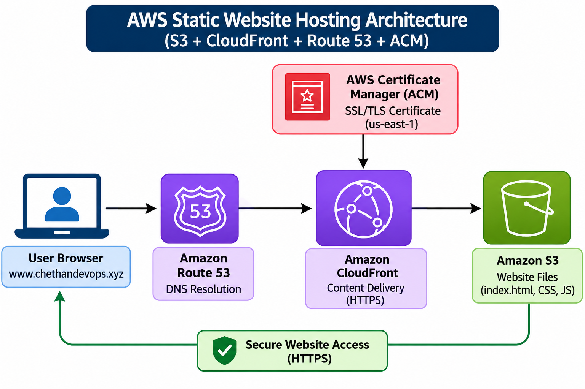
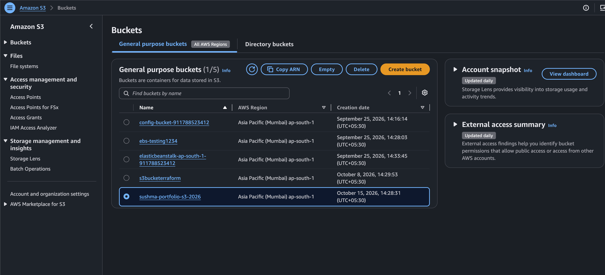
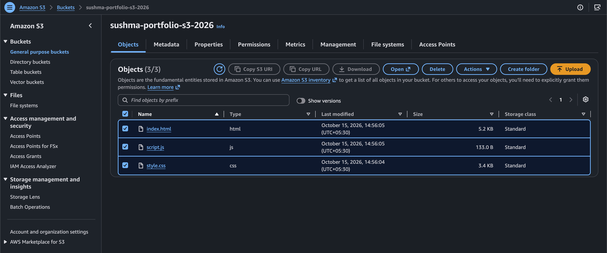
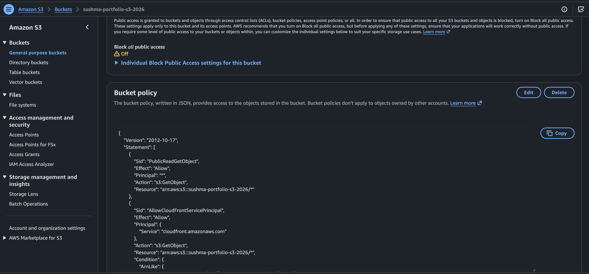
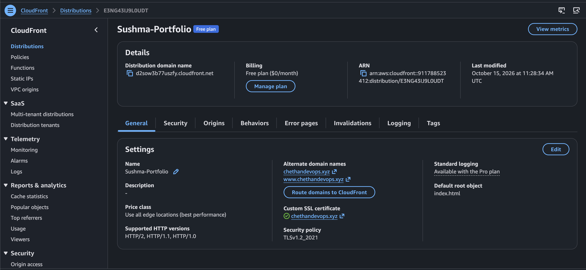
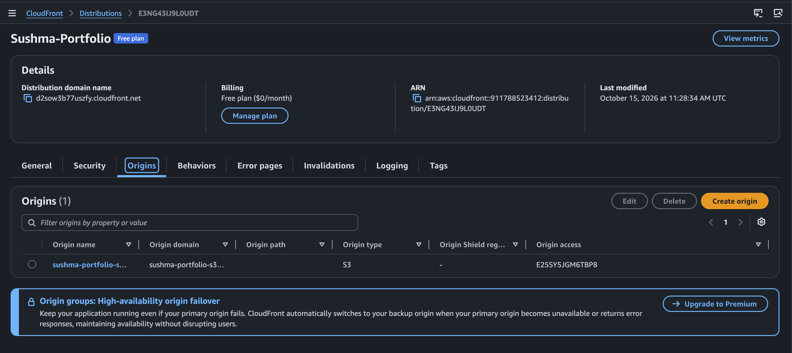
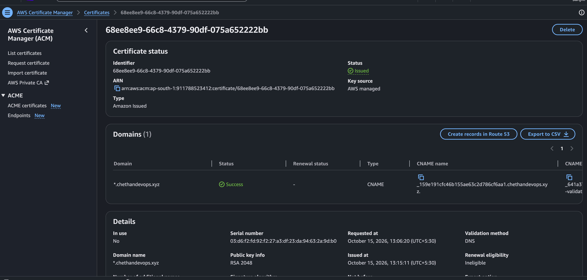
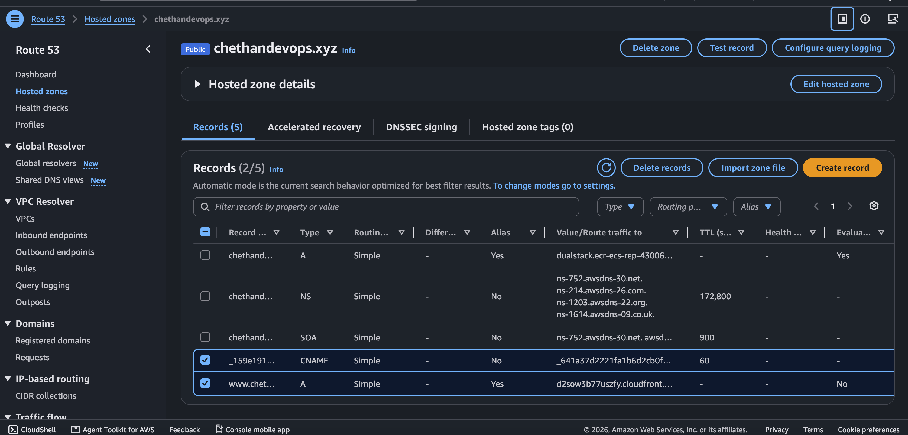
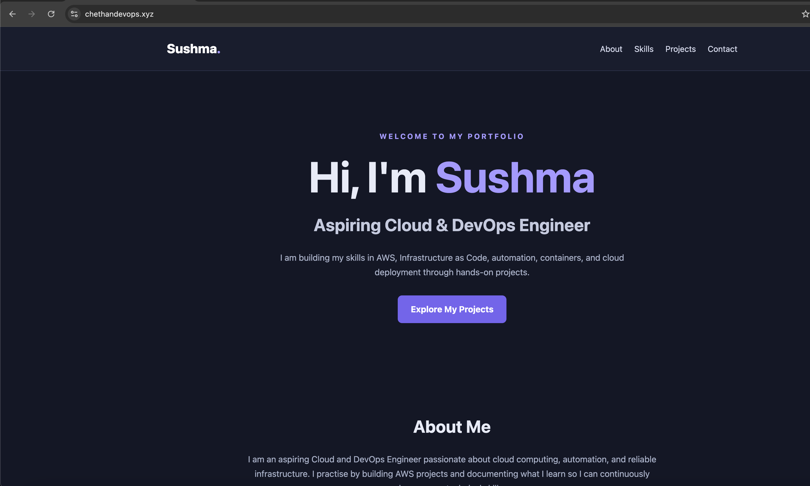

# Day 19 – AWS Static Website Hosting and Secure Content Delivery Using S3, CloudFront, Route 53 & ACM

## Project Overview

This project demonstrates how I hosted my personal portfolio website on AWS using Amazon S3 and Amazon CloudFront. I configured a custom domain using Amazon Route 53 and enabled secure HTTPS access using AWS Certificate Manager (ACM).

The objective of this hands-on lab was to understand how different AWS services work together to host, distribute and securely deliver a static website over the internet.

**Project Type:** Individual Hands-on Lab  
**Domain:** Cloud Computing – AWS  
**Focus:** Static Website Hosting, Content Delivery, DNS and HTTPS

## Architecture Diagram

The following diagram represents the AWS architecture implemented in this project.



## Architecture Flow

The request flow explains how a user accesses the portfolio website through the custom domain.

1. **User Browser:** The user enters the custom domain `www.chethandevops.xyz` in the browser.
2. **Amazon Route 53:** Route 53 resolves the domain using the configured DNS records.
3. **Amazon CloudFront:** The DNS record directs the request to the CloudFront distribution.
4. **Amazon S3:** CloudFront retrieves the requested website files from the configured S3 origin.
5. **AWS Certificate Manager:** The ACM certificate enables HTTPS between the user's browser and CloudFront.
6. **Website Delivery:** CloudFront delivers the website content to the user's browser securely.

**Request Flow:**

`User Browser → Route 53 → CloudFront → Amazon S3 → Website Content`

## AWS Services Used

| AWS Service | Purpose |
|---|---|
| Amazon S3 | Stores static website files such as HTML, CSS and JavaScript |
| Amazon CloudFront | Distributes website content through AWS edge locations |
| Amazon Route 53 | Manages DNS records for the custom domain |
| AWS Certificate Manager (ACM) | Manages the SSL/TLS certificate used for HTTPS |

## Project Configuration

| Component | Configuration |
|---|---|
| S3 Bucket | `sushma-portfolio-s3-2026` |
| AWS Region | `ap-south-1` (Mumbai) |
| CloudFront Distribution | `Sushma-Portfolio` |
| CloudFront Domain | `d2sow377uszfv.cloudfront.net` |
| Custom Domain | `chethandevops.xyz` |
| WWW Domain | `www.chethandevops.xyz` |
| Default Root Object | `index.html` |
| Website Files | HTML, CSS and JavaScript |

## Website Files

The portfolio website consists of the following files:

```text
sushma-portfolio/
├── index.html
├── style.css
└── script.js
```

- **index.html:** Contains the website structure and content.
- **style.css:** Defines the website layout and styling.
- **script.js:** Contains the website's JavaScript functionality.

## Implementation Steps

### 1. Create an Amazon S3 Bucket

- Created an S3 bucket named `sushma-portfolio-s3-2026`.
- Selected the Mumbai region (`ap-south-1`).
- Prepared the bucket to store the portfolio website files.

### 2. Upload Website Files

Uploaded the following files to the S3 bucket:

- `index.html`
- `style.css`
- `script.js`

### 3. Configure S3 Permissions

- Reviewed the S3 Block Public Access settings.
- Configured the bucket policy used in the lab.
- Prepared the S3 bucket for content delivery through CloudFront.

### 4. Create a CloudFront Distribution

- Created a CloudFront distribution.
- Configured the S3 bucket as the origin.
- Configured the default root object as `index.html`.
- Added the custom domain names to the distribution.

### 5. Configure ACM Certificate

- Requested an SSL/TLS certificate through AWS Certificate Manager.
- Used DNS validation.
- Added the DNS validation record in Route 53.
- Verified that the certificate reached the `Issued` status.

### 6. Configure Route 53

- Used the hosted zone for `chethandevops.xyz`.
- Configured the required DNS records.
- Created an Alias A record pointing to the CloudFront distribution.

### 7. Test the Website

- Tested the CloudFront distribution.
- Verified website access through the custom domain.
- Confirmed that the `www` subdomain was working over HTTPS.

## Screenshots and Implementation Evidence

The following screenshots document the actual AWS configuration and final website result.

### 01. S3 Bucket Created



### 02. Website Files Uploaded



### 03. S3 Bucket Policy



### 04. CloudFront Distribution Details



### 05. CloudFront Origin Configuration



### 06. ACM SSL Certificate Issued



### 07. Route 53 Hosted Zone Records



### 08. Portfolio Website Working



## Troubleshooting and Resolutions

During this hands-on lab, I worked through the following issues.

### 1. ACM Certificate DNS Validation

**Issue:**

- After requesting the ACM certificate, its status remained `Pending validation`.
- The DNS validation record needed to be configured correctly in Route 53.

**Resolution:**

- Checked the DNS validation CNAME record.
- Verified that the record was present in the Route 53 hosted zone.
- Allowed time for DNS validation to complete.
- Verified that the ACM certificate status changed to `Issued`.

**What I learned:** ACM DNS validation depends on the correct DNS record being available. Certificate issuance may take time after creating the validation record.

### 2. Root Domain and WWW Subdomain Accessibility

**Issue:**

- The root domain `chethandevops.xyz` was not working as expected.
- The `www.chethandevops.xyz` subdomain was accessible.

**Resolution / Workaround:**

- Verified that the `www` subdomain was working.
- Used the working `www` domain to access the portfolio website.
- Identified that the root domain and `www` subdomain require appropriate DNS configuration.

**What I learned:** The root domain and `www` subdomain are separate DNS names. Configuring one does not automatically configure the other.

## Important CloudFront and ACM Configuration Note

CloudFront requires an ACM certificate to be requested or imported in the **US East (N. Virginia) – `us-east-1`** region.

The S3 bucket can remain in `ap-south-1`; the certificate used by CloudFront must be in `us-east-1`.

## Key Learnings

Through this project, I gained hands-on experience with:

1. Hosting static website files using Amazon S3.
2. Understanding the role of CloudFront in content delivery.
3. Configuring an S3 origin for a CloudFront distribution.
4. Understanding how Route 53 DNS records route traffic to CloudFront.
5. Requesting and validating SSL/TLS certificates using ACM.
6. Configuring a custom domain for a CloudFront distribution.
7. Understanding the difference between root domains and subdomains.
8. Troubleshooting DNS validation and website accessibility issues.
9. Understanding how multiple AWS services work together to deliver a website securely.

## Project Outcome

Successfully completed an individual AWS hands-on lab by hosting a personal portfolio website using Amazon S3 and Amazon CloudFront, configuring a custom domain through Route 53, and enabling HTTPS using AWS Certificate Manager.

The `www.chethandevops.xyz` subdomain was verified as accessible over HTTPS.

---

**Author:** Sushma  
**Role:** Aspiring Cloud & DevOps Engineer  
**Project:** AWS Static Website Hosting – Day 19  
**Repository:** [AWS Cloud & DevOps Hands-on](https://github.com/asushma6112000-gif/aws-cloud-devops-hands-on)
