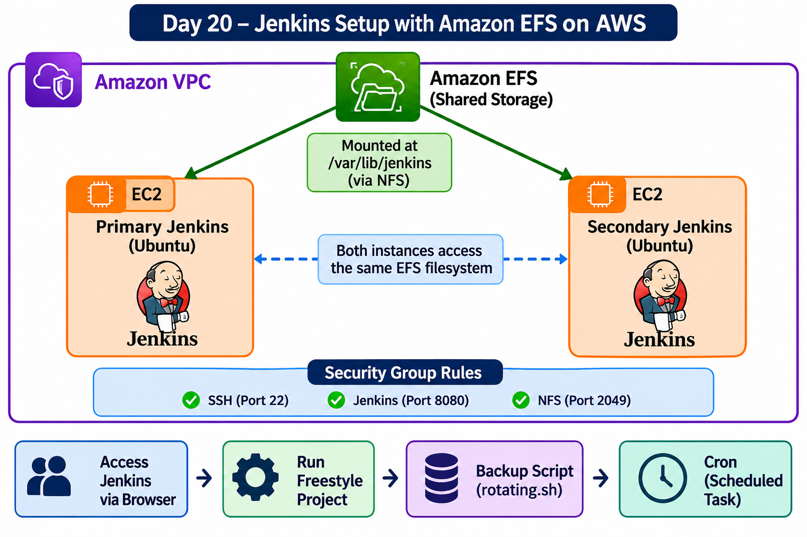
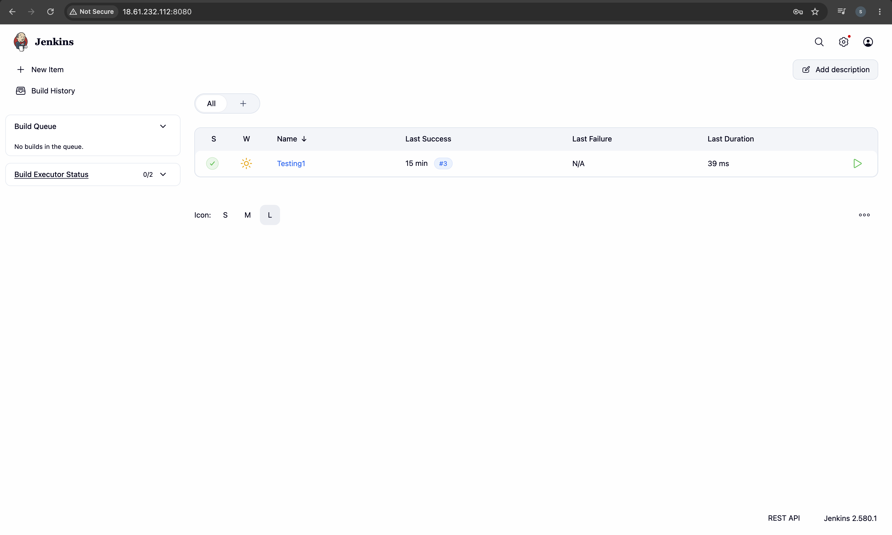
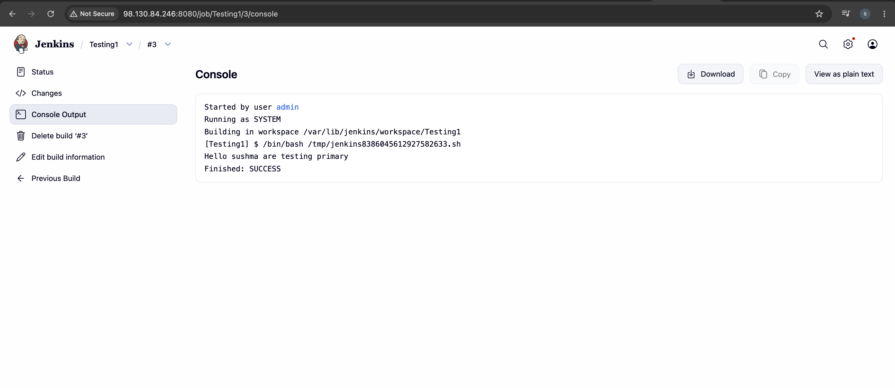
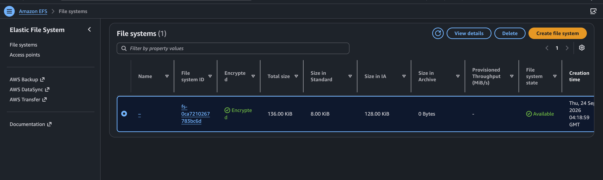
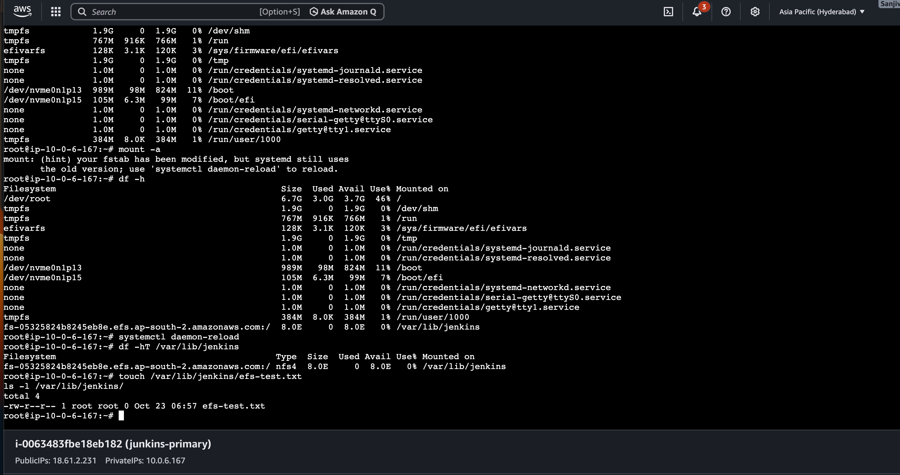
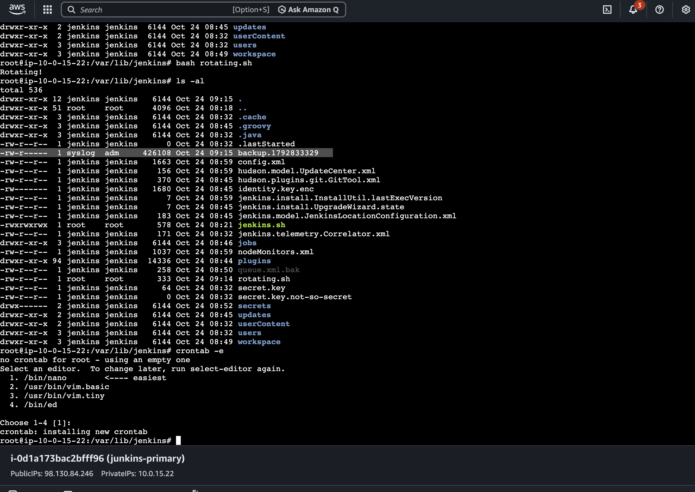
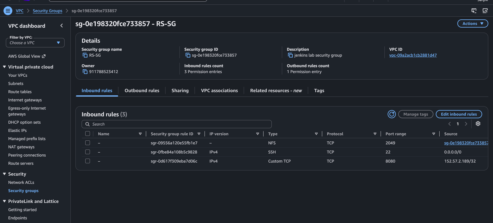
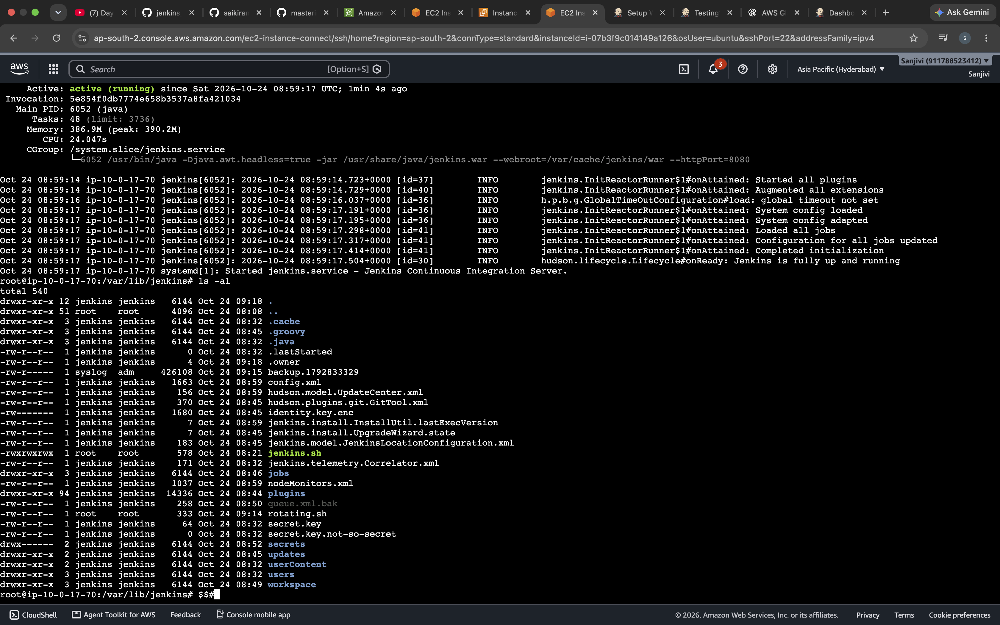

# Day 20 – Jenkins Setup with Amazon EFS on AWS

## 1. Project Overview

In this hands-on project, I configured Jenkins on two Ubuntu EC2 instances and used Amazon Elastic File System (EFS) as shared network storage.

I mounted the same Amazon EFS filesystem on both Primary and Secondary EC2 instances using NFS. The EFS filesystem was mounted at `/var/lib/jenkins`, which is the Jenkins home directory.

I also installed Jenkins on both instances, created a Jenkins Freestyle project, tested a successful build, practised a backup shell script and configured cron.

The main objective was to understand how Jenkins can use shared network storage on AWS.

## 2. Project Objectives

- Launch two Ubuntu EC2 instances.
- Install and configure Jenkins on both instances.
- Create an Amazon EFS filesystem.
- Configure EFS mount targets and network access.
- Mount the same EFS filesystem on both EC2 instances.
- Configure persistent EFS mounting using `/etc/fstab`.
- Create and execute a Jenkins Freestyle project.
- Create and manually execute a backup script.
- Practise cron configuration.
- Configure the required security group rules.

## 3. Architecture Diagram

The architecture below represents the infrastructure created during this hands-on project.



### Architecture Flow

1. AWS EC2 provides two Ubuntu instances: Primary Jenkins and Secondary Jenkins.
2. Jenkins is installed on both EC2 instances.
3. Amazon EFS provides shared network storage.
4. Both EC2 instances connect to the same EFS filesystem using NFS on TCP port 2049.
5. EFS is mounted at `/var/lib/jenkins` on both instances.
6. The Primary Jenkins instance runs a Freestyle project named `Testing1`.
7. A backup script named `rotating.sh` is executed manually.
8. Cron is configured to practise scheduled task configuration.

## 4. AWS Services and Technologies Used

| Service / Technology | Purpose |
|---|---|
| Amazon EC2 | Hosts Primary and Secondary Jenkins servers |
| Amazon EFS | Provides shared network storage |
| Amazon VPC | Provides network connectivity |
| Security Groups | Controls network traffic |
| Ubuntu | Operating system |
| Jenkins | Continuous Integration automation |
| NFS | Connects EC2 instances to EFS |
| Linux Shell Script | Performs backup operations |
| Cron | Configures scheduled tasks |

## 5. Implementation Steps

### Step 1: Launch Two EC2 Instances

- Opened the AWS EC2 console.
- Launched two Ubuntu EC2 instances.
- Configured the required security groups.
- Connected to both instances using SSH.

The instances were used as:

- Primary Jenkins server
- Secondary Jenkins server

### Step 2: Install Java

Installed Java because Jenkins requires Java to run.

```bash
sudo apt update
sudo apt install fontconfig openjdk-21-jre -y
```

Verified Java:

```bash
java -version
```

### Step 3: Install Jenkins

Added the Jenkins package repository and installed Jenkins on both EC2 instances.

Started and enabled Jenkins:

```bash
sudo systemctl enable jenkins
sudo systemctl start jenkins
```

Checked Jenkins service status:

```bash
sudo systemctl status jenkins
```

Verified that the Jenkins service was active and running.

### Step 4: Access Jenkins Dashboard

Accessed Jenkins through a browser using the EC2 public IP address and port 8080.

```text
http://EC2-PUBLIC-IP:8080
```

Completed the initial Jenkins setup and accessed the dashboard.

### Step 5: Create Amazon EFS

- Opened the Amazon EFS console.
- Created an EFS filesystem.
- Configured the filesystem for the EC2 environment.
- Created the required mount targets.
- Checked filesystem availability and network configuration.

### Step 6: Configure Security Groups

Configured the required inbound rules.

| Port | Protocol | Purpose |
|---|---|---|
| 22 | TCP | SSH access |
| 8080 | TCP | Jenkins web interface |
| 2049 | TCP | NFS access to EFS |

NFS access was configured for the EC2 instances through the appropriate network security rules.

### Step 7: Install NFS Client

Installed the required NFS client package on both EC2 instances.

```bash
sudo apt update
sudo apt install nfs-common -y
```

### Step 8: Mount EFS on Both Jenkins Servers

Created the Jenkins mount directory:

```bash
sudo mkdir -p /var/lib/jenkins
```

Mounted the EFS filesystem:

```bash
sudo mount -t nfs4 -o nfsvers=4.1 \
fs-05325824b8245eb8e.efs.ap-south-2.amazonaws.com:/ \
/var/lib/jenkins
```

The same EFS filesystem was mounted on both Primary and Secondary EC2 instances.

### Step 9: Configure Persistent EFS Mounting

Edited the `/etc/fstab` file:

```bash
sudo vi /etc/fstab
```

Added the EFS mount entry:

```text
fs-05325824b8245eb8e.efs.ap-south-2.amazonaws.com:/ /var/lib/jenkins nfs4 defaults,netdev 0 0
```

This configuration allows EFS to be mounted automatically during system startup.

Tested the configuration:

```bash
sudo mount -a
```

Verified the mounted filesystem:

```bash
df -h
```

Also checked:

```bash
mount | grep efs
```

### Step 10: Verify Jenkins Home Directory

Checked the Jenkins home directory:

```bash
ls -la /var/lib/jenkins
```

Verified Jenkins-related folders and files, including:

- jobs
- workspace
- plugins
- users
- configuration files

Created a test file to verify EFS storage:

```bash
sudo touch /var/lib/jenkins/efs-test.txt
```

Verified the file:

```bash
ls -l /var/lib/jenkins/
```

### Step 11: Create a Jenkins Freestyle Project

Created a Jenkins Freestyle project named:

`Testing1`

Configured the build step to execute shell commands.

Example:

```bash
echo "Hello sushma are testing primary"
hostname
date
ls -la /var/lib/jenkins
```

Executed the Jenkins build and checked the console output.

**Build result: SUCCESS**

The console output confirmed that the build executed successfully.

### Step 12: Create and Execute a Backup Script

Created a shell script named:

`rotating.sh`

The script was used to practise backup operations for the Jenkins directory.

Executed the script manually:

```bash
bash rotating.sh
```

Terminal output:

```text
Rotating!
```

Checked the directory:

```bash
ls -lh /var/lib/jenkins/
```

A backup-named file was visible in the directory.

### Step 13: Configure Cron

Opened the crontab editor:

```bash
crontab -e
```

Selected an editor when prompted and practised configuring a scheduled task.

Checked the installed cron configuration:

```bash
crontab -l
```

The backup script was executed manually. Cron configuration was installed and practised, but automatic scheduled execution was not separately verified.

## 6. Troubleshooting and How I Fixed It

During this hands-on project, I practised checking and resolving configuration issues involving Jenkins, EFS, NFS and Linux.

### Issue 1: Jenkins Service Verification

**Problem:** Needed to confirm whether Jenkins was running correctly after installation.

**How I checked and fixed it:**

```bash
sudo systemctl status jenkins
```

Started Jenkins and enabled it at system startup when required:

```bash
sudo systemctl start jenkins
sudo systemctl enable jenkins
```

**Result:** Verified that Jenkins was active and running.

### Issue 2: EFS Mount Configuration

**Problem:** Needed to connect the EC2 instances to the EFS filesystem.

**How I fixed it:**

Installed the NFS client:

```bash
sudo apt install nfs-common -y
```

Created the mount directory:

```bash
sudo mkdir -p /var/lib/jenkins
```

Mounted the EFS filesystem using its DNS name:

```bash
sudo mount -t nfs4 -o nfsvers=4.1 \
fs-05325824b8245eb8e.efs.ap-south-2.amazonaws.com:/ \
/var/lib/jenkins
```

**Result:** Mounted the same EFS filesystem on both EC2 instances.

### Issue 3: Persistent EFS Mounting

**Problem:** Needed the EFS filesystem to mount automatically after an instance restart.

**How I fixed it:**

Added the EFS entry to `/etc/fstab` and tested it:

```bash
sudo mount -a
```

**Result:** Configured persistent mounting through `/etc/fstab`.

### Issue 4: EFS Network Connectivity

**Problem:** EFS requires network access from EC2 instances through NFS.

**How I checked it:**

Reviewed the security group inbound rules.

Verified that TCP port 2049 was allowed from the trusted EC2 security group or network.

**Result:** Configured the required NFS network access.

### Issue 5: Jenkins Home Directory Verification

**Problem:** Needed to check whether the Jenkins directory was available on the mounted filesystem.

**How I checked it:**

```bash
df -h
ls -la /var/lib/jenkins
mount | grep efs
```

Created a test file:

```bash
sudo touch /var/lib/jenkins/efs-test.txt
```

**Result:** Verified the mounted directory and test file.

### Issue 6: Backup Script Verification

**Problem:** Needed to test whether the backup script executed.

**How I checked it:**

```bash
bash rotating.sh
```

Checked the directory contents:

```bash
ls -lh /var/lib/jenkins/
```

**Result:** The script displayed `Rotating!`, and a backup-named file was visible.

### Issue 7: Cron Configuration

**Problem:** Needed to practise configuring a scheduled task.

**How I fixed it:**

Opened the crontab editor:

```bash
crontab -e
```

Checked the installed configuration:

```bash
crontab -l
```

**Result:** Practised and installed cron configuration. Automatic scheduled backup execution was not separately verified.

## 7. Project Screenshots

### 1. Jenkins Dashboard



### 2. Jenkins Successful Build



### 3. EFS Filesystem Created



### 4. EFS Mount Verification



### 5. Jenkins Backup Script and Cron



### 6. Security Group Rules



### 7. Secondary Jenkins Status



## 8. What I Learned

By completing this hands-on project, I learned:

- How to launch and configure two EC2 instances.
- How to install and run Jenkins on Ubuntu.
- How to create an Amazon EFS filesystem.
- How EFS mount targets provide network access.
- How to connect EC2 instances to EFS using NFS.
- How to mount the same EFS filesystem on multiple EC2 instances.
- How to configure persistent mounts using `/etc/fstab`.
- How to verify mounted filesystems using Linux commands.
- How to create and execute Jenkins Freestyle jobs.
- How to check Jenkins build console output.
- How to create and execute Linux shell scripts.
- How to practise cron configuration.
- How to check Jenkins services and EFS mounts.
- How to configure security groups for application and storage access.
- How shared network storage works in an AWS environment.

## 9. Project Outcome

Successfully completed a hands-on AWS lab involving two Jenkins EC2 instances and a shared Amazon EFS filesystem.

Both Primary and Secondary EC2 instances were configured to mount the same EFS filesystem at `/var/lib/jenkins`.

The Jenkins `Testing1` Freestyle project executed successfully. I also created and manually executed a backup script and practised cron configuration.

This project helped me understand Jenkins installation, shared network storage, NFS mounting, persistent filesystem configuration, Linux scripting and basic backup scheduling.

## 10. Repository Structure

```text
Day-20-Jenkins-EFS/
│
├── README.md
├── architecture.png
│
└── screenshots/
    ├── 01-jenkins-dashboard.png
    ├── 02-jenkins-successful-build.png
    ├── 03-efs-filesystem-created.png
    ├── 04-efs-mount-verification.png
    ├── 05-jenkins-backup-script-and-cron.png
    ├── 06-security-group-rules.png
    └── 07-secondary-jenkins-status.png
```

---

**Project:** Day 20 – Jenkins with Amazon EFS

**Platform:** Amazon Web Services (AWS)

**Hands-on Technologies:** EC2, Jenkins, EFS, NFS, Ubuntu, Linux Shell Scripting and Cron
